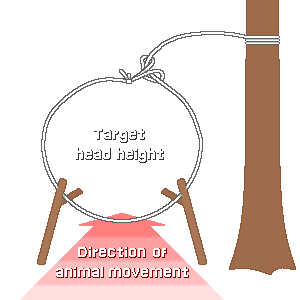
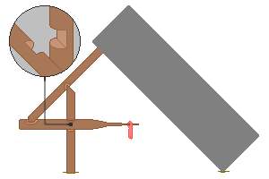

## 2. 陷阱按原理分类
&nbsp;&nbsp;&nbsp;陷阱按储存什么力、如何释放来分类，最容易理解。储存的力只有动物自身的动能、重力、木头的弹性、地形这四种，所有陷阱都是其中一种或两种的组合。

---
### 2-1. 按力的来源分类
| 分类 | 力的来源 | 代表形态 | 制作难度 |
| --- | --- | --- | :---: |
| 套索 | 动物自身的前进运动 | 颈部套索、脚套索 | 非常容易 |
| 自动套索 | 弯曲树木的弹性势能 | 弹簧套索 | 中等 |
| 压砸陷阱 | 重力，沉重的石头或原木 | 4字形（figure-4）、派尤特式 | 困难 |
| 坑阱 | 地形和重力 | 坑、桶陷阱 | 劳动量非常大 |
| 囚笼陷阱 | 结构的不可逆性 | 箱式陷阱、鱼笼、蟹笼 | 中等 |
| 网 | 缠绕 | 捕鸟网、抛网 | 需要很多绳子 |

---
### 2-2. 套索

&nbsp;&nbsp;&nbsp;最简单、使用最广的陷阱。在绳端做一个环，并设置绳结或固定件，使环只能朝一个方向变小。动物把头伸进环里继续前进，环就会收紧，收紧后的环即使动物后退也不会再变大。这是把动物的前进动能转换为收紧能量的单向转换装置。

- 不会退回的结构很重要。单靠绳结做成的环，动物一后退就会松开而逃脱，所以要加一个起锁扣作用的小环或拧结。
- 铁丝能保持弯曲后的形状，所以这个问题自动解决了。这就是铁丝套索的成功率高于植物纤维套索的原因。

| 要素 | 标准 | 理由 |
| --- | --- | --- |
| 环的直径 | 目标动物头宽的1.5倍左右 | 小了头进不去，大了身体会钻过去 |
| 环的高度 | 兔类距地面8-10cm | 与动物抬头的高度相符 |
| 固定对象 | 活树或打得很深的木桩 | 被动物拖走就无法回收 |
| 绳的强度 | 动物体重的数倍 | 被捕的动物挣扎的力量远大于体重 |
| 环的支撑 | 用细树枝或草茎立着 | 环塌下去就不起作用 |

&nbsp;&nbsp;&nbsp;固定对象的选择是失败的常见原因。把套索系在细树枝上，动物会折断树枝，带着套索一起跑掉。人什么也得不到，动物脖子上缠着绳子慢慢死去。固定在粗大的活树或打得很深的木桩上，是设陷阱的人最起码的责任。

---
### 2-3. 自动套索与弹性能量
&nbsp;&nbsp;&nbsp;利用储存在弯曲的小树或弯下的树枝中的弹性势能。把树像弓一样弯下，用触发机关固定，再连接套索。动物被套住并碰到触发机关时，树伸直，把动物吊到空中。

- 优点1：动物脚踩不到地面，无法挣扎弄断绳子或拔出固定件。
- 优点2：被吊起的动物，其他捕食者很难吃到。被简单套索套住的动物，常在人来之前被狐狸或野猫抢走。
- 缺点：能量在树里储存太久，纤维会发生塑性变形而失去弹性。挂了几天的自动套索，伸直的力比最初弱得多，成功率下降。冬天冻硬的树枝几乎失去弹性，解冻时甚至会自己触发。

---
### 2-4. 压砸陷阱

&nbsp;&nbsp;&nbsp;把沉重的物体斜着支起来，动物一碰支撑物就塌下来的结构。关键是让很小的力就能使很大的重量塌下，这就是触发机关结构存在的理由。

- 数字4形触发器：竖杆、斜杆、饵杆三根互相抓住的形态，各接触点只靠浅槽咬合。从上面压下的大重量经过三根杆而改变方向并被分散，饵杆端只剩下非常小的水平力。动物碰到饵并扰乱这个力，接触点就松开，整体瞬间塌下。就像杠杆放大力一样，触发机关放大的是对力的灵敏度。
- 派尤特式：斜杆和饵杆不直接咬合，而是用绳连接，使饵杆在更轻的触碰下就脱开。比4字形触发器灵敏，也更易制作，但多一个部件。

| 项目 | 标准 | 理由 |
| --- | --- | --- |
| 落下物的重量 | 目标动物体重的5倍以上 | 不能当场致死的话，动物会逃脱或长时间受苦 |
| 落下物的形状 | 宽而平的石头或原木 | 圆的会滚动而偏离，并留下缝隙 |
| 支撑高度 | 刚好够目标动物钻进去 | 高了动物会直接穿过 |
| 底面 | 铺上平整的石头或原木 | 泥土底面的话，动物被压着也会刨进去而存活 |
| 接触点的加工 | 浅槽，光滑的面 | 挖深了不易松开，不起作用 |

&nbsp;&nbsp;&nbsp;重量比5倍以上，是能否当场致死的分界值。不够重的话，动物只是受伤后逃脱，在别处慢慢死去。人得不到食物，动物丧了命，是最坏的结果，所以在重量上省事并不划算。

---
### 2-5. 坑阱、捕鸟陷阱、水中陷阱
- 坑式陷阱：原理最简单，但劳动量压倒性地大。挖一个齐腰深的坑所消耗的热量，比做几十个陷阱还多，还需要想办法隐藏挖出来的地方。只有在已确认大型动物必经的通道、人手较多、能分几天轮流挖的时候才考虑。在底部立尖木桩，肯定能捕到动物，但对人同样致命。
- 捕鸟陷阱：鸟不沿地面通道行走，而是聚集在降落点和食物处。把细绳织成的网立在树枝之间或水边，飞来的鸟看不见而撞上去，被缠住。网目做到目标鸟的头能钻进去的程度。把网拉得紧绷的话鸟会被弹开，所以要松松地垂着。松弛的网在鸟撞上时会形成口袋把它裹住。

| 陷阱 | 对象 | 原理 |
| --- | --- | --- |
| 捕鸟网 | 小型鸟类 | 撞上看不见的网，缠在松弛的网目里 |
| 诱饵陷阱 | 地栖鸟类 | 撒谷物引诱，使支起的篮子塌下 |
| 脚套索束 | 水边的鸟类 | 在浅水边铺设多个小套索，使脚被套住 |
| 瓶坑陷阱 | 啮齿类 | 掉进壁面光滑的容器里就爬不上来 |
| 蟹笼、鱼笼 | 螃蟹、虾、鱼 | 从漏斗入口进去后，沿着壁面绕圈而出不来 |
| 饵线 | 螃蟹、小龙虾 | 把饵拴在绳上，它们咬住后连同挂着的一起提起 |

&nbsp;&nbsp;&nbsp;水中的陷阱比陆上陷阱有很多优势。在水里，人的气味会扩散并被稀释，引起的警戒较少；被捕的个体在水中，夏天腐败也慢；螃蟹和虾这类容易捕的对象也会一起进来。陆上不具备设置陷阱的条件时，首先考虑它。