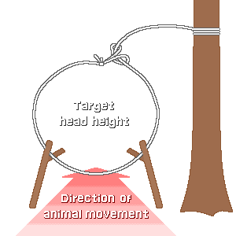
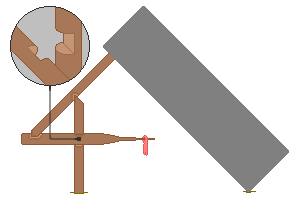

## 2. 按原理分类的陷阱
&nbsp;&nbsp;&nbsp;陷阱不该按外观分类，而应按它储存并释放的是哪种力来理解，这样更容易掌握。可储存的力只有四种：动物自身的动能、重力、树木的弹性，以及地形。所有陷阱都是这四种之中一种、或两种的组合。

---
### 2-1. 按力的来源分类
| 分类 | 力的来源 | 代表形式 | 制作难度 |
| --- | --- | --- | :---: |
| 套索 | 动物自身的前进运动 | 颈部套索、脚部套索 | 非常容易 |
| 自动套索 | 弯曲树木的弹性势能 | 弹簧套索 | 中等 |
| 压杀式陷阱 | 重力、沉重的石块或原木 | 数字4式（figure-4）、派尤特式 | 困难 |
| 陷坑 | 地形与重力 | 坑洞、筒式陷坑 | 劳动量非常大 |
| 箱式陷阱 | 结构的不可逆性 | 箱式陷阱、笼、蟹笼 | 中等 |
| 网 | 缠绕 | 鸟网、抛网 | 需要大量绳索 |

---
### 2-2. 套索收紧的原理

  

&nbsp;&nbsp;&nbsp;套索是最简单、却也是应用最广的陷阱。绳端打成一个圈，并加上绳结或卡扣，使这个圈只能朝一个方向缩小。动物把头伸进圈里继续前进，圈就会收紧；收紧后的圈即使动物向后退，也不会再变大。也就是说，套索是一种把动物前进的动能转换为收紧力的单向转换装置。

&nbsp;&nbsp;&nbsp;这里的关键在于不可逆的结构。只用绳结打成的圈，动物一后退就会松开脱身，因此必须加入起卡扣作用的小圈或绞转结构。如果能用铁丝，铁丝本身能保持弯折的形状，这个问题就自动解决了，因此铁丝套索的成功率高于植物纤维套索。

| 要素 | 标准 | 原因 |
| --- | --- | --- |
| 圈的直径 | 目标动物头宽的1.5倍左右 | 太小头伸不进去，太大身体也会穿过去 |
| 圈的高度 | 兔类离地8~10cm | 要对准动物抬头的高度 |
| 固定物 | 活树或深深打入的木桩 | 动物拖着跑就无法回收 |
| 绳的强度 | 动物体重的数倍 | 动物一旦被捉住，挣扎的力量会远超其体重 |
| 圈的支撑 | 用细枝或草茎撑起 | 圈一旦塌下，就完全无法触发 |

&nbsp;&nbsp;&nbsp;固定物选择不当是失败的常见原因。把套索绑在细枝上，动物会折断那根枝条，把整个套索拖走。这样一来，人一无所获，动物则脖子上缠着绳子慢慢死去。之所以要固定在粗壮的活树或深深打入的木桩上，不是为了效率，而是因为这是布设陷阱者最起码的责任。

---
### 2-3. 自动套索与弹性能
&nbsp;&nbsp;&nbsp;自动套索利用的是弯曲的小树或弯折的树枝中储存的弹性势能。把树像弓一样弯下，用扳机固定住，再把套索系在这棵树上。动物被套索缠住并触动扳机后，树身弹回伸直，把动物吊到空中。

&nbsp;&nbsp;&nbsp;这种方式比普通套索优越之处有两点。第一，动物的脚无法着地，就无法挣扎着咬断绳子或拔出卡扣。第二，被吊起的动物很难被其他捕食者叼走。而困在普通套索里的动物，常常在人来之前就被狐狸或野猫抢走。

&nbsp;&nbsp;&nbsp;不过，如果能量在树上储存太久，树木纤维会发生塑性变形而失去弹性。挂了数天的自动套索，弹开的力道会比刚设好时弱得多，这就是自动套索的成功率会随时间下降的原因。冬天冻住的树枝弹性几乎消失，解冻时还可能自己触发。

---
### 2-4. 压杀式陷阱与力的传递

  

&nbsp;&nbsp;&nbsp;压杀式陷阱的结构是把沉重的物体斜靠支起，动物一碰支撑物就会塌落下来。关键在于让很大的重量能被极小的力触发，这正是扳机结构存在的理由。

&nbsp;&nbsp;&nbsp;其中最广为人知的是数字4式，即形似数字"4"的扳机。由竖杆、斜杆、饵杆三根互相支撑而成，每个接点仅靠浅浅的凹槽咬合。上方压下的巨大重量经过三根杆传递，方向改变、力度分散，到饵杆末端时只剩极小的水平力。动物一碰饵料扰动这点微小的力，接点就会松脱，整个结构瞬间垮塌。就像杠杆能放大力量一样，扳机放大的是对力的敏感度。

&nbsp;&nbsp;&nbsp;派尤特式是在此基础上加了一小段绳和一根小棍的变体。斜杆与饵杆不直接咬合，而是用绳连接，使饵杆只需极轻微的触碰就能脱开。它比数字4式更灵敏、更易制作，但需要多一个部件。

| 项目 | 标准 | 原因 |
| --- | --- | --- |
| 落下物的重量 | 目标动物体重的5倍以上 | 不能立即致死，动物就会脱身，或长时间痛苦 |
| 落下物的形状 | 宽而平的石块或原木 | 圆形的会滚开偏离，留出缝隙 |
| 支撑高度 | 刚好够目标动物钻进去的程度 | 太高动物就会直接穿过去 |
| 底面 | 铺上平坦的石块或原木 | 若是泥地，动物被压住也能挖土脱险 |
| 接点的加工 | 浅凹槽、光滑面 | 挖得太深就不易松脱，无法触发 |

&nbsp;&nbsp;&nbsp;之所以把重量比定在5倍以上，是因为能否立即致死正是由这个数值决定的。分量不够重，动物就只会受伤逃脱，然后在别处慢慢死去。人得不到食物，动物却丢了性命，这是最坏的结果，所以在重量上省心思，无论从哪个角度看都不划算。

---
### 2-5. 陷坑、捕鸟陷阱与水中陷阱
&nbsp;&nbsp;&nbsp;坑洞陷阱原理最简单，但劳动量却极大。挖一个齐人腰深的坑所耗费的热量，比做几十个陷阱还多，而且还得想办法掩盖挖出的土。只有在确认大型动物必经的通道、有多人协作、又能分好几天挖掘的情况下，才值得考虑。在坑底立起尖木桩的方式确实能稳稳拿下猎物，但必须牢记，它对人同样致命。

&nbsp;&nbsp;&nbsp;捕鸟的陷阱用的是另一种原理。鸟不沿地面通道活动，因此封锁通道的方式不管用，它们只会聚集在落脚点和食物周围。把细线织成的网架在树枝之间或水边，飞来的鸟看不见网就会一头撞上、被缠住。网眼大小要刚好能让目标鸟的头卡进去，网拉得太紧鸟会被弹开，因此必须松松垂挂——松弛的网在鸟撞上时会兜出一个口袋将它包住。

| 陷阱 | 对象 | 原理 |
| --- | --- | --- |
| 鸟网 | 小型鸟类 | 撞上看不见的网，被松弛的网眼缠住 |
| 诱饵陷阱 | 地栖鸟类 | 撒谷物引诱，碰倒支起的筐子 |
| 脚部套索群 | 水边鸟类 | 在浅水处铺开多个小套索，绊住鸟脚 |
| 瓶式陷阱 | 啮齿类 | 掉进壁面光滑的筒中就爬不上来 |
| 蟹笼、笼具 | 蟹、虾、鱼 | 从漏斗状入口进入后只能沿壁绕圈，出不来 |
| 诱饵钓线 | 蟹、螯虾 | 把饵绑在线上，等它咬住不放时钓起 |

&nbsp;&nbsp;&nbsp;水中陷阱比陆上陷阱有不少优势。水会让人的气味扩散变淡，不容易引起警觉；捕到的猎物泡在水里，即使夏天也不易腐坏；蟹和虾这类容易捕捉的对象也会一并进来。当陆上布设陷阱的条件不具备时，水中陷阱是首先该考虑的对象。
