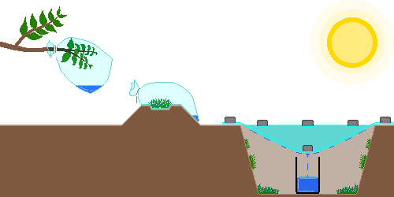
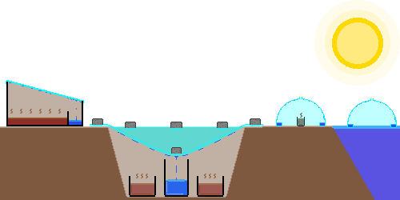
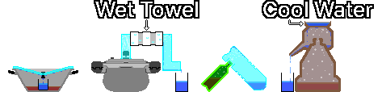

# Обеспечение питьевой водой
- Источники: Youtube, Wiki, Gemini, Claude, Chat-GPT, [CDC](https://www.cdc.gov/water-emergency/about/index.html), [EPA](https://www.epa.gov/ground-water-and-drinking-water/emergency-disinfection-drinking-water)
- Составитель: GoldBigDragon
---
## 1. Добыча воды
&nbsp;&nbsp;&nbsp;Если подача водопроводной воды прекращена или вода загрязнена, в первую очередь используйте источники с гарантированной безопасностью. К ним относятся неоткрытая бутилированная вода, баки фильтров для воды, лёд из морозилки и жидкость из консервов.

---
### 1-1. Альтернативные источники воды
&nbsp;&nbsp;&nbsp;Если источников с гарантированной безопасностью нет, в качестве крайней меры берите воду из перечисленного ниже. Неизвестно, пригодна ли она для питья, а после очистки и обеззараживания химические загрязнители могут остаться, поэтому безопасность гарантировать нельзя. По возможности используйте её только для гигиенических целей — мытья и уборки.

- Избегайте воды со взвесью, запахом и тёмным цветом.
- Воду, загрязнённую топливом, пестицидами, токсичными химикатами и радиоактивными веществами, не набирайте, потому что кипячение, фильтрация и обеззараживание не сделают её безопасной.
- В зонах боевых действий источники воды могут быть химически и биологически загрязнены из-за взрывов, разрушения объектов и утечек сточных вод, поэтому выбирайте источник особенно осторожно.

| Источник | Примечание |
| --- | --- |
| Дождевая вода | Собирайте в дождевую бочку. Пройдя по крыше и желобам, она может смешаться с птичьим помётом, пылью и металлами |
| Реки, озёра | Выбирайте места с быстрым течением. Если загрязнение выше по течению проверить нельзя, безопасность гарантировать нельзя |
| Ванна | Вода, набранная из-под крана сразу после катастрофы, загрязнена с относительно малой вероятностью. В воде, простоявшей долго, размножаются бактерии |
| Роса | До восхода солнца собирайте росу хорошо впитывающей тканью или полотенцем с чистых поверхностей — растений, металлических листов, плёнки, палаток, пластиковых листов, — на которых нет пыли и загрязнителей. Избегайте полей, обочин дорог и окрестностей промышленных объектов |
| Бак водонагревателя | Сначала отключите питание и подачу горячей воды, отбросьте осадок и используйте только прозрачную воду. Если нельзя убедиться, что бак не связан с системой отопления, не набирайте |
| Остаточная вода в трубах | Откройте кран в самой низкой точке дома. Если нельзя убедиться, что трубы не загрязнены, не набирайте |
| Поилка для домашних животных | Смешана со слюной, высока вероятность бактериального загрязнения |
| Бак увлажнителя | Высока вероятность размножения бактерий и плесени |
| Бассейн | Высок риск загрязнения хлором и химикатами, поэтому набирайте только для гигиенических целей — мытья и уборки |
| Водяной матрас | С большой вероятностью содержит альгициды и консерванты |
| Конденсат осушителя | Может быть загрязнён металлами, плесенью и бактериями |
| Вода из вазы | С большой вероятностью загрязнена подкормкой для цветов и бактериями |
| Вода из аквариума | С большой вероятностью содержит нитраты и экскременты |
| Вода из поддона цветочного горшка | С большой вероятностью загрязнена удобрениями и бактериями |
| Бачок унитаза | Используйте только воду из бачка за унитазом (не из чаши). Набирайте, только если нет химических чистящих средств; она может быть загрязнена бактериями, осадком и металлами |
| Вода из отопительного котла | Может содержать антифриз, средства от ржавчины и ингибиторы коррозии, поэтому не набирайте |
| Вода из радиатора | Может содержать антифриз, средства от ржавчины и ингибиторы коррозии, поэтому не набирайте |

---
### 1-2. Сбор влаги
&nbsp;&nbsp;&nbsp;Когда альтернативных источников не хватает, небольшое количество воды можно получить за счёт естественного испарения и конденсации или транспирации растений. Получить много трудно; полученная вода обычно чище исходной, но безопасность нельзя гарантировать, поскольку она зависит от условий установки и загрязнения, поэтому по возможности очищайте и обеззараживайте её перед использованием.

&nbsp;&nbsp;&nbsp;Одним лишь сбором влаги трудно обеспечить суточную потребность взрослого человека в воде. Используйте его как вспомогательное средство, а не основной источник, и по возможности устанавливайте несколько одновременно, чтобы увеличить количество воды.

| Способ | Содержание |
| --- | --- |
| Транспирационный пакет | Наденьте прозрачный полиэтиленовый пакет на здоровую, нетоксичную, густо облиственную ветку и герметично завяжите. Когда растение транспирирует на солнце, внутри пакета образуются капли воды. В зависимости от погоды и состояния растения даёт около 50 мл в сутки |
| Пакет с растительностью | Положите в прозрачный пакет относительно безопасный растительный материал — нетоксичную траву, листья — герметично закройте и выставьте на солнце. Загрязнители с поверхности растений могут попасть в конденсат. Даёт около 50 мл в сутки |
| Солнечный дистиллятор | Плёнкой и ёмкостью для сбора воды заставляют влагу почвы и растений испаряться и конденсироваться. Чем больше площадь поверхности ямы, тем больше площадь сбора, а чем больше материала с влагой, тем больше испарение. В неплохих условиях даёт около 250 мл в сутки, а при малой влажности почвы или низкой температуре — меньше. Если плёнка плохо герметична, эффективность падает, а при повторении на одном и том же месте влажность почвы уменьшается и выход постепенно снижается |

---

## 2. Очистка
&nbsp;&nbsp;&nbsp;Лучшая очистка не полагается на единственный способ, а поэтапно сочетает несколько методов — от удаления крупных частиц до уничтожения возбудителей.

| Этап | Содержание |
| --- | --- |
| 1. Отстаивание | Налейте мутную воду в ёмкость, подождите, пока крупные частицы осядут, и медленно слейте только относительно прозрачную воду сверху |
| 2. Фильтрация | Тканью, кофейным фильтром или самодельным фильтром из гальки, песка и угля удалите взвесь и крупные загрязнители |
| 3. Обеззараживание | Кипячением, очищающими таблетками, хлорированием удаляйте или инактивируйте болезнетворные микроорганизмы — бактерии, вирусы, простейших |
| 4. Дистилляция (по желанию) | Если химическое загрязнение не подозревается, дополнительно удаляет возбудителей, соли и многие загрязнители. Некоторые низкокипящие химические вещества, например летучие органические соединения (ЛОС), не удаляются |

&nbsp;&nbsp;&nbsp;По эффективности очистки способы обычно располагаются так: дистилляция > кипячение > фильтрация. Дистилляция эффективна для удаления микробов, солей, большинства тяжёлых металлов и неорганических загрязнителей, но низкокипящие химические вещества — ЛОС, некоторые пестициды, компоненты топлива — испаряются вместе с водой и попадают в конденсат. Для воды с подозрением на химическое загрязнение или с неизвестным источником загрязнения безопасность нельзя гарантировать даже после дистилляции.

---
### 2-1. Отстаивание
&nbsp;&nbsp;&nbsp;Под действием силы тяжести частицы в воде оседают на дно, и получается прозрачная вода. Это помогает удалить крупные частицы и особенно полезно перед кипячением очень мутной воды. Оставьте воду в ёмкости на несколько часов, и когда частицы осядут, медленно слейте только прозрачную воду сверху. Одним отстаиванием возбудителей не удалить, поэтому обязательно пройдите следующий этап очистки.

---
### 2-2. Фильтрация
#### 2-2-1. Самодельный фильтр
&nbsp;&nbsp;&nbsp;Его делают, укладывая слоями подручные материалы: ткань, кофейные фильтры, гальку, песок, уголь. Он удаляет осадок и примеси, но не удаляет вредные бактерии и паразитов, поэтому обязательно пройдите следующий этап очистки.

| Материал | Роль | Толщина |
| :---: | --- | :---: |
| Галька | Верхний слой, удаляющий самые крупные посторонние частицы | 5 см и более |
| Песок | Средний слой, фильтрующий более мелкие частицы, чем галька | 5 см и более |
| Уголь | Уменьшает запах и часть органики, улучшает вкус. Обычный уголь, в отличие от активированного, адсорбирует слабо, поэтому лишь уменьшает часть запахов и органики и не может удалить возбудителей | 5 см и более |
| Песок | Фиксирует уголь и дополнительно фильтрует | 5 см и более |
| Ткань | Кладётся в самый нижний слой для удаления мелких частиц | 3 слоя и более |

#### 2-2-2. Портативные фильтры (LifeStraw и др.)
&nbsp;&nbsp;&nbsp;Рекомендуются фильтры с абсолютным размером пор 0,2 мкм и меньше, портативные фильтры, сертифицированные по NSF P248 или NSF P231, керамические фильтры и фильтры с полыми волокнами (Hollow Fiber Membrane). Портативные фильтры тоже не удаляют химические загрязнители, например тяжёлые металлы или ЛОС.

| Сертификация | Содержание |
| :---: | --- |
| NSF P231 | Микробиологический очиститель воды (удаляет бактерии, вирусы, простейших) |
| NSF P248 | Микробиологический очиститель воды для военных операций (включая среду с высокой мутностью) |
| NSF 53 | Снижение содержания вредных для здоровья веществ (свинец, мышьяк, PFAS и др.; зависит от сертифицированного показателя) |
| NSF 58 | Системы очистки обратным осмосом (RO) (снижают содержание тяжёлых металлов, солей, примесей) |
| NSF 401 | Снижение содержания новых загрязнителей (остатки лекарств, пестициды, гербициды и др.) |

---
### 2-3. Обеззараживание
#### 2-3-1. Очищающие средства
&nbsp;&nbsp;&nbsp;Очищающие таблетки (Tablets) и капли (Drops) уничтожают химическим путём бактерии, вирусы и других возбудителей в воде. Строго соблюдайте дозировку и время выдержки из инструкции к продукту.

#### 2-3-2. Хлорный отбеливатель
&nbsp;&nbsp;&nbsp;Для очистки воды можно использовать обычный хлорный отбеливатель (гипохлорит натрия), если он без запаха, бесцветный (не Color-safe) и не содержит моющих средств, ароматизаторов и ПАВ.

- Хлор ограниченно действует на криптоспоридий (Cryptosporidium) и цисты некоторых простейших. Мутную воду обязательно отфильтруйте перед обеззараживанием. При подозрении на заражение простейшими отдавайте предпочтение кипячению или дистилляции.
- В горячей воде эффективность обеззараживания падает, поэтому по возможности используйте воду комнатной температуры. Если вода мутная, окрашенная или очень холодная, удвойте дозу.
- После добавления отбеливателя хорошо перемешайте и подождите не менее 30 минут. Если температура воды очень низкая (5 °C и ниже), обеззараживание замедляется, поэтому подождите не менее 60 минут.

&nbsp;&nbsp;&nbsp;Ниже приведён стандартный порядок применения по [CDC (Центры по контролю и профилактике заболеваний США)](https://www.cdc.gov/water-emergency/about/index.html).

| Дезинфицирующее средство | Концентрация | Доза на 1 л воды |
| --- | --- | --- |
| Гипохлорит натрия | 5-9 % | 2 капли (около 0,1 мл) |
| Гипохлорит натрия | 1 % | 10 капель (около 0,5 мл) |

#### 2-3-3. Йодная настойка
&nbsp;&nbsp;&nbsp;Йодная настойка, о которой идёт речь при обеззараживании питьевой воды, — это Tincture of Iodine: йод и йодид калия (или йодид натрия), растворённые в воде и этаноле. Это иной продукт, чем раствор Люголя 5 % или 10 % концентрации, где растворителем служит вода. Её обычно можно найти в аптечке.

- Как и хлорный отбеливатель, она ограниченно действует на криптоспоридий и цисты некоторых простейших. Мутную воду обязательно отфильтруйте перед обеззараживанием, а при подозрении на заражение простейшими отдавайте предпочтение кипячению или дистилляции.
- Это краткосрочный способ для экстренных случаев. Он не подходит беременным и людям с заболеваниями щитовидной железы, а здоровым взрослым не следует пить такую воду долго и непрерывно.

&nbsp;&nbsp;&nbsp;Ниже приведены рекомендации по экстренному обеззараживанию от [EPA (Агентство по охране окружающей среды США)](https://www.epa.gov/ground-water-and-drinking-water/emergency-disinfection-drinking-water). Они рассчитаны на 2 % йодную настойку и не применимы к раствору Люголя 5 % или 10 %. Если вода мутная, сначала фильтруйте, а если это не получается, удвойте добавляемое количество. После добавления хорошо перемешайте и подождите не менее 30 минут, а если температура воды очень низкая (5 °C и ниже), подождите не менее 60 минут.

| Дезинфицирующее средство | Концентрация | Доза на 1 л воды |
| --- | --- | --- |
| Йодная настойка | 2 % | 5 капель (около 0,25 мл) |

#### 2-3-4. Кипячение
&nbsp;&nbsp;&nbsp;Самый надёжный способ обеззараживания в экстренной ситуации. Поддерживайте сильное кипение воды не менее 1 минуты. На высоте 2 000 м и выше кипятите 3 минуты, а в экстремальных условиях на высоте 4 000 м и выше — не менее 5 минут.

#### 2-3-5. Ультрафиолетовое обеззараживание (SODIS)
&nbsp;&nbsp;&nbsp;Ультрафиолет солнца убивает микроорганизмы. Налейте воду в прозрачную бутылку без царапин, положите её на бок на солнце и оставьте на 6 часов в ясную погоду или на 2 суток в пасмурную.

- При достаточной солнечной радиации способ эффективен для уменьшения числа большинства бактерий и вирусов. В воде с высокой мутностью эффект сильно падает, поэтому сначала проведите отстаивание и фильтрацию.
- При длительном воздействии сильного ультрафиолета и тепла из ёмкости могут вымываться химические вещества. По возможности используйте стеклянные бутылки, а PET-бутылки не используйте повторно долго.

---
### 2-4. Дистилляция
&nbsp;&nbsp;&nbsp;Загрязнённую воду кипятят и собирают образующийся водяной пар, получая питьевую воду. Способ отделяет загрязнители, соли и минералы, поэтому его применяют и для превращения мутной воды и морской (солёной) воды в пресную. Низкокипящие химические вещества вроде ЛОС испаряются вместе с водой, поэтому для воды с подозрением на химическое загрязнение безопасность нельзя гарантировать даже после дистилляции.

#### 2-4-1. Солнечная дистилляция
&nbsp;&nbsp;&nbsp;Тепло солнечного света испаряет воду, а собранный испарившийся пар даёт чистую воду. Если поставить ёмкость с загрязнённой водой на чёрную поверхность, испарение ускоряется.

| Способ | Содержание |
| --- | --- |
| С одним скатом | Налейте загрязнённую воду в широкий бак и под наклоном установите прозрачную пластину (стекло, акрил, плёнку). У нижнего края ската поставьте пустую ёмкость, чтобы собирать сконденсировавшуюся воду |
| Яма в земле | Выкопайте яму, в середине поставьте пустую ёмкость, а вокруг неё — ёмкости с загрязнённой водой. Накройте яму плёнкой и закрепите камень прямо над пустой ёмкостью, чтобы пар, испарившийся от солнечного тепла, конденсировался и собирался в пустой ёмкости. Будьте осторожны, если плёнка не полностью герметична или сама пустая ёмкость загрязнена |
| Водяной конус (Water Cone) | Отрежьте верх большой PET-бутылки и загните срез внутрь на 2-3 см, чтобы получился желоб, или сделайте водосборный желоб внутри конусообразного предмета, например прозрачного зонта. Пустите его плавать по морской воде или накройте им небольшую ёмкость с загрязнённой водой и собирайте воду, сконденсировавшуюся во внутреннем желобе |

#### 2-4-2. Дистилляция с помощью кипячения
&nbsp;&nbsp;&nbsp;Воду кипятят на огне, а собранный испарившийся пар даёт чистую воду. PET-бутылки при высокой температуре деформируются, и из них могут вымываться химические вещества, поэтому обязательно используйте ёмкости из жаропрочного стекла или жаропрочного металла (нержавеющей стали и т. п.).

| Способ | Содержание |
| --- | --- |
| С перевёрнутой крышкой | Используйте кастрюлю с круглой крышкой, у которой посередине ручка, и чашку. Поставьте пустую чашку в центр кастрюли и налейте загрязнённую воду ниже высоты чашки. Накройте перевёрнутой крышкой и нагревайте: пар соберётся в центре крышки и стечёт в чашку |
| Скороварка | Подсоедините жаропрочный шланг к паровыпускному отверстию скороварки и охлаждайте холодной водой. Заполните скороварку загрязнённой водой, нагревайте и выводите выходящий пар по шлангу. Если пропустить середину шланга через ёмкость со льдом или холодной водой, пар быстро конденсируется |
| Соединение бутылок | Налейте загрязнённую воду в бутылку A из жаропрочного стекла или жаропрочного металла. В днище бутылки B из жаропрочного пластика или жаропрочного металла, в котором можно проделать отверстие, сделайте отверстие и соедините его с горлышком бутылки A. Переверните бутылку B горлышком вниз и кипятите бутылку A, перегоняя воду |
| Соджу-кори (sojutgori) | Традиционный корейский перегонный аппарат: внизу загрязнённая вода, посередине конденсационная камера в виде перевёрнутого чайника, вверху охлаждающая вода. Нагретый пар поднимается, встречает холодную верхнюю часть, конденсируется, и чистая вода вытекает из носика |

---

## 3. Хранение питьевой воды
---
### 3-1. Выбор ёмкости для хранения
&nbsp;&nbsp;&nbsp;Ёмкость для хранения питьевой воды должна быть прочной, небьющейся и из материала, подходящего для хранения продуктов.

> **Внимание:** ёмкость, в которой хранились токсичные вещества — бензин, пестициды, моющие средства, смазочные масла, — не используйте для хранения питьевой воды, как бы тщательно её ни вымыли.

| Ёмкость | Содержание |
| --- | --- |
| Бутылки из-под коммерческой питьевой воды | Невскрытая коммерческая бутилированная вода — самый безопасный и надёжный аварийный источник. Тонкие PET-бутылки при долгом использовании могут деформироваться или трескаться, поэтому для многократного повторного использования не подходят |
| Ёмкости пищевого класса | Подходят для длительного хранения питьевой воды |
| Ёмкости из HDPE | Широко применяются благодаря долговечности и химической стойкости. Убедитесь, что изделие сертифицировано для пищевого использования |
| Синие баки для воды | Те, что изготовлены для хранения питьевой воды, подходят для длительного хранения и удобны для больших запасов |
| Стеклянные бутылки | Нет опасности вымывания химических веществ, легко мыть, поэтому подходят для длительного хранения. Боятся ударов, а при замерзании воды могут разбиться |
| Термокружки из нержавеющей стали | Очень долговечны и полностью не пропускают свет, подавляя рост водорослей. При длительном хранении воды, обеззараженной хлорным отбеливателем, могут корродировать |
| Бутылки из-под напитков | Можно использовать для пищевых целей, но если остались сахар или ароматизаторы, размножаются бактерии, поэтому перед использованием тщательно вымойте и высушите |
| Керамика | Выгодна для поддержания прохлады, но трудно герметизировать, а из-за веса неудобно переносить |
| Молочные пакеты и канистры | В них легко остаются белки и жиры молока, полностью их не вымыть, есть риск размножения бактерий, поэтому для длительного хранения не рекомендуются |
| Пищевые зип-пакеты | Подходят для краткосрочного хранения или хранения в морозильнике. Легко рвутся, поэтому как основная ёмкость для хранения не годятся |
| Складные канистры | Занимают мало места, но материал тонкий и легко повреждается, а изнутри трудно мыть и сушить |
| Контейнеры для кимчи, пластиковые герметичные контейнеры | Пищевые безопасны и хорошо герметичны, но запахи еды могут впитываться и влиять на вкус воды |
| Крупные бочки пищевого назначения | Ёмкости пищевого класса, в которых хранились растительное масло, сироп и т. п., можно использовать повторно. Запахи и остатки нужно удалить полностью |
| Крупные промышленные бочки | В ёмкостях, где хранились моющие средства, смазочные масла, антифриз, химикаты, после мытья могут оставаться токсичные вещества, поэтому никогда не используйте их для хранения питьевой воды |

---
### 3-2. Мытьё ёмкостей для хранения
&nbsp;&nbsp;&nbsp;Перед наполнением питьевой водой обязательно вымойте и обеззаразьте ёмкость, чтобы не допустить роста микроорганизмов. При длительном хранении добавляйте отбеливатель (гипохлорит натрия 5-9 %) по 2 капли на 1 л воды.

1. Мытьё: хорошо вымойте ёмкость с мылом и водой и полностью ополосните.
2. Приготовление дезинфицирующего раствора: смешайте с 1 л воды около 5 мл отбеливателя без добавок — ароматизаторов, моющих средств, защиты цвета (гипохлорит натрия 5 %) — и получите дезинфицирующий раствор около 250 ppm.
3. Обеззараживание: налейте раствор в ёмкость, закройте крышку и встряхните, чтобы он коснулся всей внутренней поверхности.
4. Выдержка и слив: подождите не менее 30 секунд и вылейте раствор.
5. Сушка и наполнение: дайте высохнуть естественным путём или ополосните чистой водой после слива раствора. Затем наполните питьевой водой и герметично закройте.

---
### 3-3. Условия хранения
&nbsp;&nbsp;&nbsp;Хранимая вода со временем подвергается воздействию окружающей среды, поэтому для сохранения качества воды нужны подходящие условия и регулярный уход.

| Пункт | Содержание |
| --- | --- |
| Температура | Высокие температуры повышают вероятность старения пластика и размножения микроорганизмов. Храните в прохладном месте без больших перепадов температуры, при 10-21 °C |
| Свет | Прямые солнечные лучи разрушают пластик и способствуют росту водорослей (Algae) внутри ёмкости. Храните в тёмном месте |
| Расположение | Пищевые ёмкости из HDPE, стоящие прямо на бетонном полу, особых проблем не создают. Чтобы избежать сырости и загрязнения, храните на полках или поддонах |
| Химические вещества | Пары летучих химических веществ — бензина, пестицидов, краски, моющих средств, удобрений — могут проникать через пластик и загрязнять воду, поэтому обязательно храните отдельно |
| Проверка | Отметьте на ёмкости дату хранения и проверяйте каждые 6-12 месяцев. Воду с запахом или изменившимся цветом замените. Замененную воду используйте для уборки или в сельском хозяйстве |
| Предотвращение вторичного загрязнения | Не опускайте в ёмкость руки или грязные кружки. Используйте ёмкость с краном или приготовьте отдельный ковш для набора воды |
| Подготовка средств очистки | Не считайте, что хранимая вода всегда безопасна. Подготовьте не менее двух разных средств очистки — приспособление для кипячения, фильтр для воды, очищающие таблетки |
| Повторное насыщение кислородом | В воде при длительном хранении не хватает растворённого кислорода, и она пресная на вкус. Если перед питьём несколько раз перелить её между двумя чистыми ёмкостями, вкус улучшится |