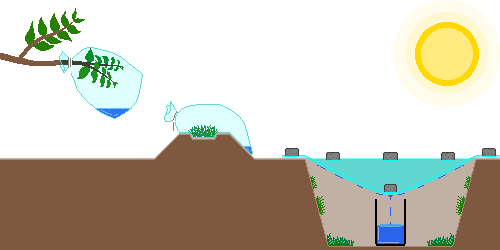
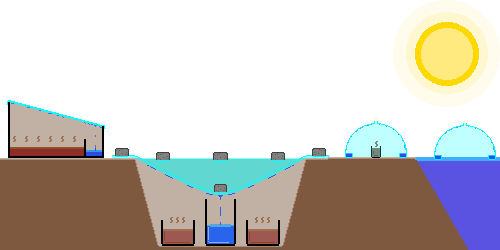
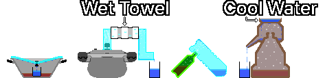

# Secure drinking water
- Source: Youtube, Wiki, Gemini, Claude, Chat-GPT, [CDC](https://www.cdc.gov/water-emergency/about/index.html), [EPA](https://www.epa.gov/ground-water-and-drinking-water/emergency-disinfection-drinking-water)
- Compiled by: GoldBigDragon
---
## 1. Securing Water
&nbsp;&nbsp;&nbsp;If the tap water supply is cut off or contaminated, use sources whose safety is guaranteed first. Unopened bottled water, water-purifier tanks, ice in the freezer, and the liquid in canned food count.

---
### 1-1. Alternative Water Sources
&nbsp;&nbsp;&nbsp;When no source with guaranteed safety is available, obtain water from the items below as a last resort. Whether the water is drinkable is unknown, and even after purification and disinfection, chemical contaminants may remain, so safety cannot be guaranteed. If possible, use it only for hygiene purposes such as washing and cleaning.

- Avoid water with suspended matter, odor, or a dark color.
- Do not collect water contaminated with fuel, pesticides, toxic chemicals, or radioactive material, because boiling, filtering, or disinfecting cannot make it safe.
- In war zones, explosions, destroyed facilities, and sewage leaks can contaminate water sources chemically and biologically, so be especially careful in choosing a source.

| Source | Notes |
| --- | --- |
| Rainwater | Collect it in a rain barrel. After passing over a roof and gutters, it may be mixed with bird droppings, dust, and metals |
| Rivers, lakes | Prefer fast-flowing spots. If you cannot confirm upstream contamination, safety cannot be guaranteed |
| Bathtub | Water stored from the tap right after a disaster is relatively unlikely to be contaminated. Water left for a long time grows bacteria |
| Dew | Before sunrise, collect dew with an absorbent cloth or towel from clean surfaces free of dust and contaminants, such as plants, metal sheets, plastic, tarps, and plastic sheeting. Avoid farmland, roadsides, and areas near industrial facilities |
| Water heater tank | Shut off the power and hot water supply first, discard the sediment, and use only the clear water. If you cannot confirm that it is not connected to a heating-water system, do not collect it |
| Residual water in pipes | Open the lowest tap in the house to collect it. If you cannot confirm whether the piping is contaminated, do not collect it |
| Pet water bowl | Saliva gets mixed in, so bacterial contamination is likely |
| Humidifier tank | Bacteria and mold are likely to grow |
| Swimming pool | The risk of chlorine and chemical contamination is high, so collect it only for hygiene purposes such as washing and cleaning |
| Waterbed | It likely contains algaecides and preservatives |
| Dehumidifier condensate | May be contaminated with metals, mold, and bacteria |
| Flower vase water | Likely contaminated with plant food and bacteria |
| Aquarium water | Likely contains nitrates and waste |
| Plant saucer water | Likely contaminated with fertilizer and bacteria |
| Toilet tank | Use only the water in the tank behind the toilet (not the bowl). Collect it only when there is no chemical cleaner, and note that it may be contaminated with bacteria, sediment, and metals |
| Boiler heating water | May contain antifreeze, rust inhibitors, and corrosion inhibitors, so do not collect it |
| Radiator water | May contain antifreeze, rust inhibitors, and corrosion inhibitors, so do not collect it |

---
### 1-2. Capturing Moisture
&nbsp;&nbsp;&nbsp;When alternative sources run short, you can get small amounts of water from natural evaporation and condensation or plant transpiration. It is hard to get much, and the water obtained is generally cleaner than the raw water but its safety cannot be guaranteed depending on the setup and contamination, so purify and disinfect it if possible.

&nbsp;&nbsp;&nbsp;Moisture capture alone can hardly provide an adult's daily water. Use it as a supplement, not the main source, and if possible set up several at the same time to increase the yield.

| Method | Details |
| --- | --- |
| Transpiration bag | Cover a healthy, leafy, non-toxic branch with a clear plastic bag and seal it. When the plant transpires in sunlight, droplets form inside the bag. It varies with weather and plant condition, but yields about 50 mL a day |
| Vegetation bag | Put relatively safe plant material such as non-toxic grass and leaves in a clear plastic bag, seal it, and expose it to sunlight. Contaminants on the plant surface may get into the condensed water. Yields about 50 mL a day |
| Solar still | Evaporate and condense moisture from soil and plants using plastic sheeting and a container to catch the water. The larger the surface area of the pit, the wider the collection area, and the more moisture-bearing material, the more evaporation. In a decent environment it yields about 250 mL a day, and less when soil moisture is low or the temperature is cold. If the plastic seal is poor, efficiency drops, and repeating at the same spot reduces soil moisture so the yield gradually declines |

---

## 2. Purification
&nbsp;&nbsp;&nbsp;The best purification does not rely on a single method but combines several techniques in stages, from removing large particles to killing pathogens.

| Step | Details |
| --- | --- |
| 1. Sedimentation | Put muddy water in a container, wait for large particles to settle, and slowly pour off only the relatively clear water on top |
| 2. Filtration | Use cloth, coffee filters, or an improvised filter of gravel, sand, and charcoal to remove suspended matter and large contaminants |
| 3. Disinfection | Use boiling, purification tablets, or chlorine disinfection to remove or inactivate pathogenic microbes such as bacteria, viruses, and protozoa |
| 4. Distillation (optional) | When chemical contamination is not suspected, it additionally removes pathogens, salt, and many contaminants. Some low-boiling chemicals such as volatile organic compounds (VOCs) are not removed |

&nbsp;&nbsp;&nbsp;Purification performance generally ranks distillation > boiling > filtering. Distillation is effective at removing microbes, salt, and most heavy metals and inorganic contaminants, but low-boiling chemicals such as VOCs, some pesticides, and fuel components vaporize together and mix into the condensate. For water suspected of chemical contamination or of unknown contamination source, safety cannot be guaranteed even after distillation.

---
### 2-1. Sedimentation
&nbsp;&nbsp;&nbsp;Gravity settles particles in the water to the bottom to give clear water. It is useful for removing large particles, and especially useful before boiling very muddy water. Put the water in a container for a few hours, and once the particles settle, slowly pour off only the clear water on top. Sedimentation alone does not remove pathogens, so always go through the next purification step.

---
### 2-2. Filtration
#### 2-2-1. Improvised Filter
&nbsp;&nbsp;&nbsp;Build it by stacking materials at hand in layers, such as cloth, coffee filters, gravel, sand, and charcoal. It removes sediment and impurities but not harmful bacteria or parasites, so always go through the next purification step.

| Material | Role | Thickness |
| :---: | --- | :---: |
| Gravel | The top layer, removing the largest foreign matter | 5 cm or more |
| Sand | The middle layer, filtering finer particles than gravel | 5 cm or more |
| Charcoal | Reduces odor and some organic matter and improves taste. Ordinary charcoal, unlike activated carbon, adsorbs weakly, so it only reduces some odor and organic matter and cannot remove pathogens | 5 cm or more |
| Sand | Holds the charcoal in place and filters further | 5 cm or more |
| Cloth | Laid on the very bottom layer to remove fine particles | 3 or more layers |

#### 2-2-2. Portable Filters (LifeStraw, etc.)
&nbsp;&nbsp;&nbsp;Filters with an absolute pore size of 0.2 µm or smaller, portable filters certified to NSF P248 or NSF P231, ceramic filters, and hollow fiber membrane filters are recommended. Even portable filters cannot remove chemical contaminants such as heavy metals or VOCs.

| Certification | Details |
| :---: | --- |
| NSF P231 | Microbiological water purifier (removes bacteria, viruses, protozoa) |
| NSF P248 | Military-operation microbiological water purifier (including high-turbidity environments) |
| NSF 53 | Reduction of health-related contaminants (lead, arsenic, PFAS, etc.; varies by certified item) |
| NSF 58 | Reverse osmosis (RO) systems (reduce heavy metals, salts, impurities) |
| NSF 401 | Reduction of emerging contaminants (pharmaceutical residues, pesticides, herbicides, etc.) |

---
### 2-3. Disinfection
#### 2-3-1. Purification Tablets and Drops
&nbsp;&nbsp;&nbsp;Purification tablets and drops use chemicals to kill bacteria, viruses, and other pathogens in the water. Follow the dosage and waiting time in the product instructions strictly.

#### 2-3-2. Chlorine Bleach
&nbsp;&nbsp;&nbsp;Ordinary chlorine bleach (sodium hypochlorite) that is unscented, plain (not color-safe), and free of cleaners, fragrances, and surfactants can be used to purify water.

- Chlorine has limited effect on Cryptosporidium and some protozoan cysts. Always filter turbid water before disinfecting. If protozoan contamination is suspected, give priority to boiling or distillation.
- Disinfection weakens if it is put into hot water, so use room-temperature water if possible. If the water is turbid, colored, or very cold, double the dose.
- After adding the bleach, mix well and wait at least 30 minutes. If the water temperature is very low (5 °C or below), disinfection is slower, so wait at least 60 minutes.

&nbsp;&nbsp;&nbsp;Below is the standard usage from the [CDC (US Centers for Disease Control and Prevention)](https://www.cdc.gov/water-emergency/about/index.html).

| Disinfectant | Concentration | Amount per 1 L of water |
| --- | --- | --- |
| Sodium hypochlorite | 5-9% | 2 drops (about 0.1 mL) |
| Sodium hypochlorite | 1% | 10 drops (about 0.5 mL) |

#### 2-3-3. Tincture of Iodine
&nbsp;&nbsp;&nbsp;The iodine tincture used in drinking-water disinfection is Tincture of Iodine, iodine and potassium iodide (or sodium iodide) dissolved in water and ethanol. It is different from Lugol's solution at 5% or 10% concentration, which uses water as the solvent. It is commonly found in medicine cabinets and first-aid kits.

- Like chlorine bleach, it has limited effect on Cryptosporidium and some protozoan cysts. Always filter turbid water before disinfecting, and if protozoan contamination is suspected, give priority to boiling or distillation.
- It is a short-term method for emergencies. It is unsuitable for pregnant women and people with thyroid conditions, and even healthy adults should not drink it continuously for long periods.

&nbsp;&nbsp;&nbsp;Below are the emergency disinfection guidelines from the [EPA (US Environmental Protection Agency)](https://www.epa.gov/ground-water-and-drinking-water/emergency-disinfection-drinking-water). They are based on 2% tincture of iodine and cannot be applied to 5% or 10% Lugol's solution. If the water is turbid, filter first, but if that is not feasible, double the amount added. After adding, mix well and wait at least 30 minutes, and if the water temperature is very low (5 °C or below), wait at least 60 minutes.

| Disinfectant | Concentration | Amount per 1 L of water |
| --- | --- | --- |
| Tincture of iodine | 2% | 5 drops (about 0.25 mL) |

#### 2-3-4. Boiling
&nbsp;&nbsp;&nbsp;The most reliable disinfection method in an emergency. Keep the water at a rolling boil for at least 1 minute. At altitudes of 2,000 m and above, boil for 3 minutes, and in extreme environments of 4,000 m and above, for at least 5 minutes.

#### 2-3-5. Ultraviolet Disinfection (SODIS)
&nbsp;&nbsp;&nbsp;The sun's ultraviolet light kills microbes. Fill a clear, scratch-free bottle with water, lay it on its side in the sun, and leave it for 6 hours on a clear day or 2 days on a cloudy day.

- With enough sunshine, it is effective at reducing most bacteria and viruses. Its effect falls greatly in highly turbid water, so do sedimentation and filtration first.
- Long exposure to strong ultraviolet light and heat can make chemicals leach out of the container. Use glass bottles if possible, and do not reuse PET bottles for long.

---
### 2-4. Distillation
&nbsp;&nbsp;&nbsp;Boil contaminated water and collect the steam to make drinking water. It separates out contaminants, salt, and minerals, so it is also used to turn muddy water and seawater (salt water) into fresh water. Low-boiling chemicals such as VOCs vaporize together, so safety cannot be guaranteed even after distillation for water suspected of chemical contamination.

#### 2-4-1. Solar Distillation
&nbsp;&nbsp;&nbsp;Sunlight's heat evaporates the water, and the vapor is collected to get clean water. Placing the container of contaminated water on a black surface speeds evaporation.

| Method | Details |
| --- | --- |
| Single-slope type | Put contaminated water in a wide basin and set a clear plate (glass, acrylic, or plastic sheeting) at a slope. Place an empty container at the lower end of the slope to collect the condensed water |
| Pit method | Dig a hole, put an empty container in the middle, and place containers of contaminated water around it. Cover the hole with plastic sheeting and fix a stone right above the empty container so that vapor evaporated by solar heat condenses and collects in the empty container. Be careful if the plastic is not fully sealed or the empty container itself is contaminated |
| Water cone | Cut off the top of a large PET bottle and fold the cut edge 2-3 cm inward to make a channel, or make a water-collecting channel inside a cone-shaped object such as a clear umbrella. Float it on seawater or place it over a small container of contaminated water, and collect the water that condenses in the inner channel |

#### 2-4-2. Distillation by Boiling
&nbsp;&nbsp;&nbsp;Boil water over a fire and collect the evaporated steam to get clean water. PET bottles can deform at high temperatures and leach chemicals, so always use heat-resistant glass or heat-resistant metal (such as stainless steel) containers.

| Method | Details |
| --- | --- |
| Inverted-lid method | Use a pot with a round lid that has a handle in the middle, and a cup. Put the empty cup in the center of the pot and fill the pot with contaminated water to below the height of the cup. Cover with the lid upside down and heat; the steam gathers at the center of the lid and drips into the cup |
| Pressure cooker | Attach a heat-resistant hose to the steam vent of the pressure cooker and cool it with cold water. Fill it with contaminated water and heat it, and lead the steam out through the hose. If you run the middle of the hose through a container with ice or cold water, the steam condenses quickly |
| Bottle-joint method | Put contaminated water in heat-resistant glass or heat-resistant metal bottle A. Make a hole in the bottom of bottle B, which is heat-resistant plastic or heat-resistant metal that can be drilled, and join it to the mouth of bottle A. Turn bottle B with its mouth facing down and boil bottle A to distill |
| Soju gori | A traditional Korean distillation apparatus with contaminated water at the bottom, a condensing chamber shaped like an inverted kettle in the middle, and cooling water at the top. The heated steam rises, meets the cold top, condenses, and the clean water flows out of the spout |

---

## 3. Storing Drinking Water
---
### 3-1. Choosing a Storage Container
&nbsp;&nbsp;&nbsp;A container for storing drinking water must be sturdy, unbreakable, and made of a material suitable for food storage.

> **Caution:** Never use a container that held toxic substances such as gasoline, pesticides, detergents, or lubricants for drinking water, however thoroughly it is washed.

| Container | Details |
| --- | --- |
| Commercial water bottles | Unopened commercial bottled water is the safest and most reliable emergency source. Thin PET bottles can deform or crack with long use, so they are not suitable for repeated reuse |
| Food-grade containers | Suitable for long-term storage of drinking water |
| HDPE containers | Widely used for their durability and chemical resistance. Check that the product is certified for food use |
| Blue water tanks | Those made for drinking-water storage are suitable for long-term storage and good for bulk stockpiling |
| Glass bottles | No worry about chemical leaching and easy to wash, so suitable for long-term storage. Fragile, and may break if the water freezes |
| Stainless steel tumblers | Very durable, and block light completely, suppressing algae. Long-term storage of water disinfected with chlorine bleach can corrode them |
| Beverage bottles | Usable for food, but bacteria grow if sugar or flavoring remains, so wash thoroughly and dry before use |
| Ceramics | Good at keeping the temperature cool, but hard to seal fully and heavy to move |
| Milk cartons, milk jugs | Milk protein and fat tend to remain, making a complete wash difficult and creating a risk of bacterial growth, so not recommended for long-term storage |
| Food-grade zipper bags | Suitable for short-term or freezer storage. They tear easily and are unsuitable as the main storage container |
| Collapsible water containers | Take little space but are thin and easily damaged, and hard to wash and dry inside |
| Kimchi containers, plastic airtight containers | Food-grade ones are safe and seal well, but food odors can soak in and affect the taste of water |
| Large food-grade drums | Food-grade containers that held cooking oil, syrup, and the like can be reused. Odors and residues must be removed completely |
| Large industrial drums | Containers that held detergent, lubricants, antifreeze, or chemicals may still hold toxic substances after washing, so never use them for drinking-water storage |

---
### 3-2. Cleaning Storage Containers
&nbsp;&nbsp;&nbsp;Always wash and disinfect a container before filling it with drinking water, to prevent microbial growth. For long-term storage, add 2 drops of bleach (sodium hypochlorite 5-9%) per 1 L of water.

1. Wash: Wash the container thoroughly with soap and water and rinse completely.
2. Make the disinfectant: Mix about 5 mL of bleach with no additives such as fragrance, cleaner, or color protector (sodium hypochlorite 5%) into 1 L of water to make a disinfectant of about 250 ppm.
3. Disinfect: Pour the disinfectant into the container, close the lid, and shake it so it touches the entire inner surface.
4. Wait and drain: Wait at least 30 seconds, then discard the disinfectant.
5. Dry and fill: Air dry, or rinse with clean water after discarding the disinfectant. Then fill with drinking water and seal.

---
### 3-3. Managing the Storage Environment
&nbsp;&nbsp;&nbsp;Stored water is affected by its surroundings over time, so a suitable environment and regular management are needed to maintain water quality.

| Item | Details |
| --- | --- |
| Temperature | High temperatures raise the likelihood of plastic aging and microbial growth. Store in a cool place without large temperature changes, 10-21 °C |
| Light | Direct sunlight degrades plastic and promotes algae growth inside the container. Store in the dark |
| Location | Food-grade HDPE containers are not a big problem touching a concrete floor directly. To prevent moisture and contamination, store on shelves or pallets |
| Chemicals | Vapors of volatile chemicals such as gasoline, pesticides, paint, detergents, and fertilizer can pass through plastic and contaminate the water, so always keep them separate |
| Inspection | Mark the storage date on the container and inspect every 6-12 months. Replace water that smells or is discolored. Use the replaced water for cleaning or agriculture |
| Preventing secondary contamination | Do not put hands or dirty cups into the container. Use a container with a tap or prepare a dedicated ladle for taking water out |
| Preparing purification methods | Do not assume stored water is always safe. Prepare at least two different purification methods, such as a boiling tool, a water filter, and purification tablets |
| Re-aeration | Long-stored water lacks dissolved oxygen and tastes flat. Pouring it back and forth a few times between two clean containers before drinking improves the taste |