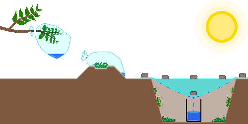
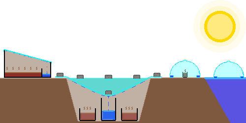
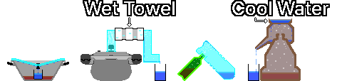

# 飲料水の確保
- 出典: Youtube, Wiki, Gemini, Claude, Chat-GPT, [CDC](https://www.cdc.gov/water-emergency/about/index.html), [EPA](https://www.epa.gov/ground-water-and-drinking-water/emergency-disinfection-drinking-water)
- 編集者: GoldBigDragon
---
## 1. 水の確保
&nbsp;&nbsp;&nbsp;水道の供給が止まったり汚染されたりしたときは、安全が保証された水源を優先して使います。未開封のミネラルウォーター、浄水器のタンク、冷凍庫の氷、缶詰の汁が該当します。

---
### 1-1. 代わりの水源
&nbsp;&nbsp;&nbsp;安全が保証された水源がないときは、最後の手段として、以下の項目から水を確保します。飲用できるかどうか分からず、浄水・消毒をしても化学的な汚染物質が取り除かれないことがあるため、安全を保証できません。できれば、洗浄や掃除のような衛生目的だけに使います。

- 浮遊物、におい、暗い色のある水は避けます。
- 燃料、農薬、有毒な化学物質、放射性物質に汚染された水は、煮沸・ろ過・消毒で安全にできないため、確保しません。
- 戦争地域は、爆発、施設の破壊、下水の流出で水源が化学的・生物学的に汚染されることがあるため、水源の選択にとりわけ注意します。

| 水源 | 備考 |
| --- | --- |
| 雨水 | 雨水タンクにためます。屋根と雨どいを通ると、鳥のふん、ほこり、金属成分が混ざることがあります |
| 川、湖 | 流れの速い地点を優先します。上流の汚染を確認できなければ、安全を保証できません |
| 浴槽 | 災害直後に水道水でためておいた水は、汚染の可能性が比較的低いです。長く放置した水は細菌が増えます |
| 露 | 日の出前に、吸水性のよい布・タオルで、ほこりや汚染物質のない植物・金属板・ビニール・テント・プラスチックシートなど、きれいな表面の露を集めます。農地、道路沿い、産業施設の近くは避けます |
| 給湯器のタンク | 電源とお湯の供給源を先に遮断してから、沈殿物は捨て、澄んだ水だけを使います。暖房水とつながったシステムかどうか確認できなければ、確保しません |
| 配管内の残留水 | 家で最も低い所の蛇口を開けて確保します。配管の汚染を確認できなければ、確保しません |
| ペットの給水器 | 唾液が混ざり、細菌に汚染されている可能性が高いです |
| 加湿器のタンク | 細菌・カビが増えている可能性が高いです |
| プール | 塩素・化学薬品の汚染の危険が高いため、洗浄や掃除などの衛生目的だけに確保します |
| ウォーターベッド | 殺藻剤と防腐剤が含まれている可能性が高いです |
| 除湿機の凝縮水 | 金属成分、カビ、細菌に汚染されている可能性があります |
| 花瓶の水 | 栄養剤・細菌に汚染されている可能性が高いです |
| 水槽の水 | 硝酸塩・排泄物が含まれている可能性が高いです |
| 植木鉢の受け皿の水 | 肥料・細菌に汚染されている可能性が高いです |
| トイレのタンク | トイレの後ろ側にあるタンクの水だけを使います(用を足す便器は除く)。化学洗浄剤がない場合にのみ確保し、細菌、沈殿物、金属成分に汚染されている可能性があります |
| ボイラーの暖房水 | 不凍液、防錆剤、腐食抑制剤が含まれていることがあるため、確保しません |
| ラジエーターの水 | 不凍液、防錆剤、腐食抑制剤が含まれていることがあるため、確保しません |

---
### 1-2. 水分の捕集
&nbsp;&nbsp;&nbsp;代わりの水源が不足したときは、自然の蒸発・凝縮や、植物の蒸散作用で、少量の水を得られます。多くの量を得るのは難しく、得た水は一般に原水よりきれいですが、設置環境や汚染の有無によって安全を保証できないため、できれば浄水・消毒をしてから使います。

&nbsp;&nbsp;&nbsp;水分の捕集だけでは、成人1人の1日分の水分を確保するのは困難です。主な水源ではなく補助手段として使い、できれば複数を同時に設置して確保量を増やします。

| 方法 | 内容 |
| --- | --- |
| 蒸散袋 | 毒がなく葉の多い健康な枝に透明なビニール袋をかぶせ、密封します。日光で植物が蒸散すると、ビニールの内側に水滴がつきます。気象条件と植物の状態によって異なりますが、1日に約50mLを得ます |
| 植物袋 | 毒のない草・葉など、比較的安全な植物材料を透明なビニール袋に入れて密封し、日光にさらします。植物の表面の汚染物質が凝縮水に混ざることがあります。1日に約50mLを得ます |
| 太陽熱蒸留 | ビニールと水を受ける器で、土壌や植物の水分を蒸発・凝縮させて得ます。穴の表面積が大きいほど集水面積が広く、水分を含む物質が多いほど蒸発量が増えます。まずまずの環境で1日に約250mLを得て、土壌の水分が少ないか気温が低いと、これより少なくなります。ビニールの密封が不十分だと効率が落ち、同じ場所で繰り返すと土壌の水分が減って、生産量が徐々に減ります |

---

## 2. 浄水
&nbsp;&nbsp;&nbsp;最もよい浄水は、単一の方法に頼らず、大きな粒子の除去から病原菌の殺滅まで、複数の技術を段階的に組み合わせることです。

| 段階 | 内容 |
| --- | --- |
| 1. 沈殿 | 泥水は容器に入れて、大きな粒子が沈むのを待ってから、上層の比較的澄んだ水だけをゆっくり注ぎ出します |
| 2. ろ過 | 布、コーヒーフィルター、砂利・砂・炭などを使った簡易フィルターで、浮遊物と大きな汚染物質を取り除きます |
| 3. 殺菌 | 煮沸、浄水剤、塩素消毒などで、細菌・ウイルス・原虫のような病原性微生物を取り除くか、不活化します |
| 4. 蒸留(任意) | 化学物質の汚染が疑われないときに、病原菌、塩分、多くの汚染物質をさらに取り除きます。揮発性有機化合物(VOC)など、一部の低沸点の化学物質は取り除かれません |

&nbsp;&nbsp;&nbsp;浄水の性能は、一般に蒸留 > 煮沸 > ろ過の順です。蒸留は、微生物、塩分、大部分の重金属と無機汚染物質の除去に効果的ですが、VOC・一部の農薬・燃料成分のような低沸点の化学物質は、一緒に気化して凝縮水に混ざります。化学物質の汚染が疑われる水や、汚染源が分からない水は、蒸留した後も安全を保証できません。

---
### 2-1. 沈殿
&nbsp;&nbsp;&nbsp;重力で水中の粒子を底に沈め、澄んだ水を得ます。大きな粒子の除去に役立ち、泥の多い水を煮沸する前に特に役立ちます。水を容器に入れて数時間置き、粒子が沈んだら、上層の澄んだ水だけをゆっくり注ぎ出します。沈殿だけでは病原菌が取り除かれないため、次の浄水段階を必ず経ます。

---
### 2-2. ろ過
#### 2-2-1. 簡易フィルター
&nbsp;&nbsp;&nbsp;布、コーヒーフィルター、砂利、砂、炭など、身近な材料を層状に重ねて作ります。沈殿物と不純物は取り除けますが、有害な細菌や寄生虫は取り除けないため、次の浄水段階を必ず経ます。

| 材料 | 役割 | 厚さ |
| :---: | --- | :---: |
| 砂利 | 最上層で最も大きな異物を除去 | 5cm以上 |
| 砂 | 砂利より細かい粒子をこす中間層 | 5cm以上 |
| 炭 | におい、一部の有機物を減らし、味を改善。一般の炭は活性炭と違って吸着力が低く、一部のにおい・有機物を減らす効果しかなく、病原菌の除去は不可能 | 5cm以上 |
| 砂 | 炭を固定し、さらにろ過 | 5cm以上 |
| 布 | 最下層に敷いて微細な粒子を除去 | 3枚以上 |

#### 2-2-2. 携帯用フィルター(LifeStrawなど)
&nbsp;&nbsp;&nbsp;絶対孔径0.2µm以下のフィルター、NSF P248またはNSF P231の認証を受けた携帯用フィルター、セラミックフィルター、中空糸膜(Hollow Fiber Membrane)フィルターをお勧めします。携帯用フィルターでも、重金属やVOCのような化学汚染物質は取り除けません。

| 認証 | 内容 |
| :---: | --- |
| NSF P231 | 微生物用の浄水器(細菌・ウイルス・原虫を除去) |
| NSF P248 | 軍事作戦用の微生物浄水器(高濁度の環境を含む) |
| NSF 53 | 健康に有害な物質の低減(鉛・ヒ素・PFASなど。認証項目ごとに異なる) |
| NSF 58 | 逆浸透(RO)浄水システム(重金属、塩類、不純物を低減) |
| NSF 401 | 新興汚染物質の低減(医薬品の残留物、殺虫剤、除草剤など) |

---
### 2-3. 殺菌
#### 2-3-1. 浄水剤
&nbsp;&nbsp;&nbsp;浄水剤(Tablets)とドロップ(Drops)は、化学物質で水中の細菌、ウイルス、その他の病原菌を死滅させます。製品の説明書の用量と待ち時間を厳守します。

#### 2-3-2. 塩素系漂白剤
&nbsp;&nbsp;&nbsp;一般の塩素系漂白剤(次亜塩素酸ナトリウム)のうち、無香料・無色(Color-safeではない)で、洗剤・香料・界面活性剤が入っていない製品は、浄水に使えます。

- 塩素は、クリプトスポリジウム(Cryptosporidium)と一部の原虫のシストには効果が限られます。濁った水は必ずろ過してから消毒します。原虫の汚染が疑われる場合は、煮沸か蒸留を優先します。
- 高温の水に入れると消毒効果が落ちるので、なるべく室温の水を使います。水が濁っていたり色がついていたりとても冷たかったりする場合は、投入量を2倍にします。
- 漂白剤を入れたあとよく混ぜ、30分以上待ちます。水温がとても低い場合(5℃以下)は消毒が遅くなるので、60分以上待ちます。

&nbsp;&nbsp;&nbsp;以下は、[CDC(米国疾病予防管理センター)](https://www.cdc.gov/water-emergency/about/index.html)の標準的な使い方です。

| 消毒剤 | 濃度 | 水1Lあたりの投入量 |
| --- | --- | --- |
| 次亜塩素酸ナトリウム | 5-9% | 2滴(約0.1mL) |
| 次亜塩素酸ナトリウム | 1% | 10滴(約0.5mL) |

#### 2-3-3. ヨードチンキ
&nbsp;&nbsp;&nbsp;飲料水の消毒でいうヨードチンキは、ヨウ素とヨウ化カリウム(またはヨウ化ナトリウム)を水とエタノールに溶かした Tincture of Iodine です。水を溶媒にした5%または10%濃度のルゴール液とは別の製品です。薬品棚や救急箱でよく見つかります。

- 塩素系漂白剤と同様に、クリプトスポリジウムと一部の原虫のシストには効果が限られます。濁った水は必ずろ過してから消毒し、原虫の汚染が疑われる場合は、煮沸か蒸留を優先します。
- 緊急時の短期的な消毒法です。妊婦と甲状腺疾患のある人には不適切で、健康な成人でも長期間続けて飲まないようにします。

&nbsp;&nbsp;&nbsp;以下は、[EPA(米国環境保護庁)](https://www.epa.gov/ground-water-and-drinking-water/emergency-disinfection-drinking-water)の緊急消毒の指針です。2%のヨードチンキを基準にしており、5%または10%のルゴール液には適用できません。水が濁っていればろ過を優先しますが、難しい場合は添加量を2倍にします。添加後はよく混ぜて30分以上待ち、水温がとても低い場合(5℃以下)は60分以上待ちます。

| 消毒剤 | 濃度 | 水1Lあたりの投入量 |
| --- | --- | --- |
| ヨードチンキ | 2% | 5滴(約0.25mL) |

#### 2-3-4. 煮沸
&nbsp;&nbsp;&nbsp;緊急時に最も確実な殺菌法です。水が強く沸騰した状態を1分以上保ちます。標高2,000m以上では3分、4,000m以上の極限環境では最低5分煮沸します。

#### 2-3-5. 紫外線消毒(SODIS)
&nbsp;&nbsp;&nbsp;太陽の紫外線で微生物を死滅させます。透明で傷のない瓶に水を入れ、横に寝かせて日なたに、晴れた日は6時間、曇りの日は2日間置きます。

- 日射量が十分あれば、ほとんどの細菌とウイルスの減少に効果的です。濁度が高い水では効果が大きく落ちるので、沈殿とろ過を先に行います。
- 強い紫外線と熱に長くさらされると、容器の化学物質が溶け出すことがあります。なるべくガラス瓶を使い、PETボトルは長く再利用しません。

---
### 2-4. 蒸留
&nbsp;&nbsp;&nbsp;汚れた水を沸かして発生した水蒸気を集め、飲料水を作ります。汚染物質、塩分、ミネラルを分離するので、泥水や海水(塩水)を淡水に変えるのにも使います。VOCのような低沸点の化学物質は一緒に気化するため、化学物質の汚染が疑われる水は、蒸留した後も安全を保証できません。

#### 2-4-1. 太陽熱蒸留
&nbsp;&nbsp;&nbsp;日光の熱で水を蒸発させ、蒸発した水蒸気を集めて、きれいな水を得ます。汚れた水を入れた容器を黒い底面に置くと、蒸発の速度が速まります。

| 方法 | 内容 |
| --- | --- |
| 単一傾斜型 | 広い水槽に汚れた水を入れ、透明な板(ガラス・アクリル・ビニール)を傾けて設置します。傾斜の端に空の器を置いて、凝縮した水を集めます |
| 穴掘り方式 | 地面を掘って真ん中に空の器を置き、その周りに汚れた水を入れた器を置きます。穴をビニールで覆い、空の器のすぐ上に石を固定して、太陽熱で蒸発した水蒸気が凝縮して空の器にたまるようにします。ビニールが完全に密閉されていなかったり、空の器自体が汚れていたりする場合は注意します |
| ウォーターコーン | 大きなペットボトルの上部を切り、切り口を内側に2-3cm折り込んで水路を作るか、透明な傘など円錐形の物の内側に受水路を作ります。海水の上に浮かべるか、汚れた水を入れた小さな容器の上にかぶせて、内側の水路に凝縮した水を集めます |

#### 2-4-2. 煮沸を利用した蒸留
&nbsp;&nbsp;&nbsp;火で水を沸かし、蒸発した水蒸気を集めて、きれいな水を得ます。PETボトルは高温で変形し、化学物質が溶け出す危険があるため、必ず耐熱ガラスや耐熱金属(ステンレスなど)の容器を使います。

| 方法 | 内容 |
| --- | --- |
| ふたを逆さにする方式 | 中央に取っ手のある丸いふたの鍋とコップを使います。鍋の中央に空のコップを入れ、コップの高さより低く汚れた水を満たします。ふたを逆さにしてかぶせて加熱すると、水蒸気がふたの中央に集まってコップの中に落ちます |
| 圧力鍋 | 圧力鍋の蒸気排出口に耐熱ホースをつなぎ、冷水で冷却します。汚れた水を満たして加熱し、出てくる蒸気をホースで逃がします。ホースの途中を氷か冷水の入った容器に通すと、蒸気が速く凝縮します |
| 瓶をつなぐ方式 | 耐熱ガラスまたは耐熱金属の瓶Aに汚れた水を入れます。耐熱プラスチックまたは穴を開けられる耐熱金属の瓶Bの底に穴を開け、瓶Aの口と結合します。瓶Bの口を下に向けて逆さにし、瓶Aを沸かして蒸留します |
| ソジュコリ | 下段に汚れた水、中段にやかんを逆さにした形の凝縮室、上段に冷却水を置く、韓国の伝統的な蒸留器具。加熱された蒸気が上へ上がり、冷たい上段に触れて凝縮し、きれいな水が排出口から流れ出ます |

---

## 3. 飲料水の保管
---
### 3-1. 保存容器の選択
&nbsp;&nbsp;&nbsp;飲料水の保存容器は、丈夫で割れにくく、食品の保管に適した素材でなければなりません。

> **注意:** ガソリン、殺虫剤、洗剤、潤滑油などの有毒物質を入れていた容器は、どんなにきれいに洗っても、飲料水の保管には使いません。

| 容器 | 内容 |
| --- | --- |
| 市販のミネラルウォーターのボトル | 未開封の市販のミネラルウォーターが、最も安全で信頼できる非常用の水源です。薄いPETボトルは、長く使うと変形したりひびが入ったりすることがあるため、繰り返しの再利用には適しません |
| 食品グレードの容器 | 飲料水の長期保管に適している |
| HDPE容器 | 耐久性と耐薬品性に優れ、広く使われています。食品用として認証された製品かを確認します |
| 青い水タンク | 飲料水の貯蔵用に作られたものは長期保管に適し、大容量の備蓄に有利 |
| ガラス瓶 | 化学物質の溶出の心配がなく洗いやすいため、長期保管に適している。衝撃に弱く、水が凍ると割れることがある |
| ステンレスのタンブラー | 耐久性に優れ、光を完全に遮断して藻の発生を抑える。塩素系漂白剤で消毒した水を長期間保管すると、腐食することがある |
| 飲料のボトル | 食品用として使えるが、糖分・香料などが残っていると細菌が繁殖するため、十分に洗って乾かしてから使う |
| 陶磁器 | 温度を涼しく保つのに有利だが、完全な密閉が難しく、重くて持ち運びが不便 |
| 牛乳パック・牛乳の容器 | 牛乳のタンパク質と脂肪が残りやすく、完全な洗浄が難しく、細菌が増える危険があるため、長期保存にはお勧めしない |
| 食品用のジッパーバッグ | 短期保管や冷凍保管に適している。簡単に破れるので、主力の保存容器としては不適切 |
| 折りたたみ式の水筒 | 場所を取らないが、素材が薄くて破損しやすく、内部の洗浄と乾燥が難しい |
| キムチ容器・プラスチックの密閉容器 | 食品用は安全で密閉力に優れるが、食べ物のにおいが染み付いて水の味に影響することがある |
| 食品用の大容量ドラム缶 | 食用油、シロップなどを入れていた食品用の容器は再利用可能。においと残留物を完全に取り除く必要がある |
| 工業用の大容量ドラム缶 | 洗剤、潤滑油、不凍液、化学薬品などを入れていた容器は、洗浄後も有毒物質が残ることがあるため、決して飲料水の保管には使わない |

---
### 3-2. 保存容器の洗浄
&nbsp;&nbsp;&nbsp;飲料水を入れる前に、必ず洗浄して消毒し、微生物の増殖を防ぎます。長期保管するときは、漂白剤(次亜塩素酸ナトリウム5-9%)を水1Lあたり2滴入れて保管します。

1. 洗浄: 容器を石鹸と水できれいに洗い、完全にすすぎます。
2. 消毒液の調製: 水1Lに、香料・洗剤・色柄物保護剤などの添加物のない漂白剤(次亜塩素酸ナトリウム5%)を約5mL混ぜて、約250ppmの消毒液を作ります。
3. 消毒: 消毒液を容器に注ぎ、ふたを閉めて、内側の全面に触れるように振ります。
4. 待機と排出: 最低30秒待ってから、消毒液を捨てます。
5. 乾燥と充填: 自然乾燥させるか、消毒液を捨てたあときれいな水ですすぎます。その後、飲料水を満たして密封します。

---
### 3-3. 保管環境の管理
&nbsp;&nbsp;&nbsp;保存した水は、時間がたつにつれて周囲の環境の影響を受けるため、水質を保つには適切な環境と定期的な管理が必要です。

| 項目 | 内容 |
| --- | --- |
| 温度 | 高い温度は、プラスチックの劣化と微生物の増殖の可能性を高めます。10-21℃の涼しく、温度変化があまり大きくない場所に保管 |
| 光 | 直射日光はプラスチックを劣化させ、容器の内側で藻類(Algae)の増殖を促します。暗い場所に保管 |
| 場所 | 食品用のHDPE容器は、コンクリートの床に直接触れても大きな問題はありません。湿気と汚染を防ぐため、棚やパレットの上に保管 |
| 化学物質 | ガソリン、殺虫剤、塗料、洗剤、肥料などの揮発性化学物質の蒸気が、プラスチックを透過して水を汚染することがあるため、必ず隔離 |
| 点検 | 容器に保存日を記入し、6-12か月ごとに点検します。においがしたり変色したりした水は交換します。交換した水は、掃除用水や農業用水として活用 |
| 二次汚染の防止 | 手や汚れたコップを容器の中に入れないでください。蛇口付きの容器を使うか、水をすくうための専用のひしゃくを用意 |
| 浄水手段の準備 | 保存した水が常に安全だと仮定しないでください。煮沸道具、浄水フィルター、浄水剤など、異なる浄水手段を最低2つ以上用意 |
| 酸素の再供給 | 長期保存した水は、溶存酸素が不足して味が平板です。飲む前にきれいな2つの容器の間で何度か注ぎ替えると、水の味が改善する |