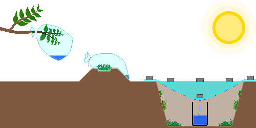
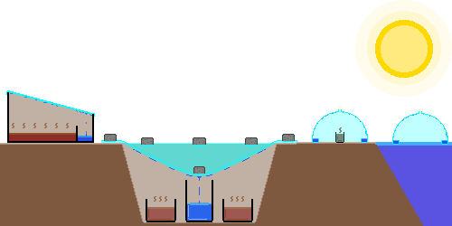
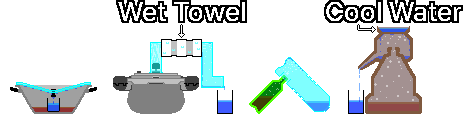

# 식수 확보
- 출처: Youtube, Wiki, Gemini, Claude, Chat-GPT, [CDC](https://www.cdc.gov/water-emergency/about/index.html), [EPA](https://www.epa.gov/ground-water-and-drinking-water/emergency-disinfection-drinking-water)
- 엮은이: GoldBigDragon
---
## 1. 물 확보
&nbsp;&nbsp;&nbsp;수돗물 공급이 중단되거나 오염되면 안전이 보장된 수원을 우선 씁니다. 미개봉 생수, 정수기 탱크, 냉동실 얼음, 통조림 국물이 해당합니다.

---
### 1-1. 대체 수원
&nbsp;&nbsp;&nbsp;안전이 보장된 수원이 없을 때 최후의 수단으로 아래 항목에서 물을 확보합니다. 음용 가능 여부를 알 수 없고, 정수·소독을 거쳐도 화학적 오염물질이 제거되지 않을 수 있어 안전을 보장할 수 없습니다. 가능하면 세척·청소 같은 위생 목적으로만 씁니다.

- 부유 물질, 냄새, 어두운 색이 있는 물은 피합니다.
- 연료, 농약, 독성 화학물질, 방사성 물질에 오염된 물은 끓이기·여과·소독으로 안전하게 만들 수 없으므로 확보하지 않습니다.
- 전쟁 지역은 폭발, 시설 파괴, 하수 유출로 수원이 화학적·생물학적으로 오염될 수 있으므로 수원 선택에 각별히 주의합니다.

| 수원 | 비고 |
| --- | --- |
| 빗물 | 빗물받이 통에 모읍니다. 지붕과 홈통을 거치면 조류 배설물, 먼지, 금속 성분이 섞일 수 있습니다 |
| 강, 호수 | 유속이 빠른 지점을 우선합니다. 상류 오염을 확인할 수 없으면 안전을 보장할 수 없습니다 |
| 욕조 | 재난 직후 수돗물로 채워 둔 물은 오염 가능성이 비교적 낮습니다. 오래 방치한 물은 세균이 증식합니다 |
| 이슬 | 해 뜨기 전에 흡수성이 좋은 천·수건으로, 먼지와 오염물질이 없는 식물·금속판·비닐·천막·플라스틱 시트 등 깨끗한 표면의 이슬을 모읍니다. 농경지, 도로변, 산업시설 인근은 피합니다 |
| 온수기 탱크 | 전원과 온수 공급원을 먼저 차단한 뒤 침전물은 버리고 맑은 물만 씁니다. 난방수와 연결된 시스템인지 확인할 수 없으면 확보하지 않습니다 |
| 파이프 잔류수 | 집에서 가장 낮은 곳의 수도꼭지를 열어 확보합니다. 배관 오염 여부를 확인할 수 없으면 확보하지 않습니다 |
| 애완동물 급수기 | 타액이 섞여 세균 오염 가능성이 높습니다 |
| 가습기 물탱크 | 세균·곰팡이 증식 가능성이 높습니다 |
| 수영장 | 염소·화학약품 오염 위험이 높아 세척·청소 등 위생 목적으로만 확보합니다 |
| 물침대 | 살조제와 방부제가 포함되었을 가능성이 높습니다 |
| 제습기 응축수 | 금속 성분, 곰팡이, 세균에 오염되었을 가능성이 있습니다 |
| 꽃병 물 | 영양제·세균 오염 가능성이 높습니다 |
| 어항 물 | 질산염·배설물 포함 가능성이 높습니다 |
| 화분 받침대 물 | 비료·세균 오염 가능성이 높습니다 |
| 변기 탱크 | 변기 뒤편 물탱크의 물만 씁니다(용변 보는 통은 제외). 화학 세정제가 없는 경우에만 확보하며, 세균·침전물·금속 성분 오염 가능성이 있습니다 |
| 보일러 난방수 | 부동액, 방청제, 부식억제제가 포함될 수 있어 확보하지 않습니다 |
| 라디에이터 물 | 부동액, 방청제, 부식억제제가 포함될 수 있어 확보하지 않습니다 |

---
### 1-2. 수분 포집
&nbsp;&nbsp;&nbsp;대체 수원이 부족하면 자연적인 증발·응결이나 식물의 증산작용으로 소량의 물을 얻을 수 있습니다. 많은 양을 얻기 어렵고, 얻은 물은 대체로 원수보다 깨끗하지만 설치 환경과 오염 여부에 따라 안전을 보장할 수 없으므로 가능하면 정수·소독을 거쳐 씁니다.

&nbsp;&nbsp;&nbsp;수분 포집만으로는 성인 1인의 하루 수분을 확보하기 어렵습니다. 주 수원이 아니라 보조 수단으로 쓰고, 가능하면 여러 개를 동시에 설치해 확보량을 늘립니다.

| 방법 | 내용 |
| --- | --- |
| 증산 봉투 | 독성이 없고 잎이 많은 건강한 나뭇가지에 투명 비닐봉투를 씌워 밀봉합니다. 햇빛으로 식물이 증산하면 비닐 내부에 물방울이 맺힙니다. 기상 조건과 식물 상태에 따라 다르지만 하루 약 50mL를 얻습니다 |
| 식생 봉투 | 독성이 없는 풀·잎 등 비교적 안전한 식물 재료를 투명 비닐봉투에 넣고 밀봉해 햇빛에 노출합니다. 식물 표면의 오염물질이 응결수에 섞일 수 있습니다. 하루 약 50mL를 얻습니다 |
| 태양열 증류 | 비닐과 물을 담을 그릇으로 토양·식물의 수분을 증발·응축시켜 얻습니다. 구덩이 표면적이 클수록 집수 면적이 넓고, 수분을 품은 물질이 많을수록 증발량이 많습니다. 괜찮은 환경에서 하루 약 250mL를 얻으며, 토양 수분이 적거나 기온이 낮으면 이보다 적습니다. 비닐 밀봉이 미흡하면 효율이 떨어지고, 같은 자리에서 반복하면 토양 수분이 줄어 생산량이 점차 감소합니다 |

---

## 2. 정수
&nbsp;&nbsp;&nbsp;가장 좋은 정수는 단일 방법에 의존하지 않고 큰 입자 제거부터 병원균 사멸까지 여러 기술을 단계적으로 결합하는 것입니다.

| 단계 | 내용 |
| --- | --- |
| 1. 침전 | 흙탕물은 용기에 담아 큰 입자가 가라앉기를 기다린 뒤 상층의 비교적 맑은 물만 천천히 따라냅니다 |
| 2. 여과 | 천, 커피 필터, 자갈·모래·숯 등을 이용한 임시 필터로 부유물과 큰 오염물질을 제거합니다 |
| 3. 살균 | 끓이기, 정수제, 염소 소독 등으로 세균·바이러스·원생동물 같은 병원성 미생물을 제거하거나 불활성화합니다 |
| 4. 증류(선택) | 화학물질 오염이 의심되지 않을 때 병원균, 염분, 다수의 오염물질을 추가로 제거합니다. 휘발성 유기화합물(VOC) 등 일부 저비점 화학물질은 제거되지 않습니다 |

&nbsp;&nbsp;&nbsp;정수 성능은 일반적으로 증류 > 끓이기 > 필터링 순입니다. 증류는 미생물, 염분, 대부분의 중금속과 무기 오염물질 제거에 효과적이지만, VOC·일부 농약·연료 성분 같은 저비점 화학물질은 함께 기화해 응축수에 섞입니다. 화학물질 오염이 의심되거나 오염원을 모르는 물은 증류 후에도 안전을 보장할 수 없습니다.

---
### 2-1. 침전
&nbsp;&nbsp;&nbsp;중력으로 물속 입자를 바닥에 가라앉혀 맑은 물을 얻습니다. 큰 입자 제거에 유용하며 진흙이 많은 물을 끓이기 전에 특히 유용합니다. 물을 용기에 담아 몇 시간 두고, 입자가 가라앉으면 상층의 맑은 물만 천천히 따라냅니다. 침전만으로는 병원균이 제거되지 않으므로 다음 정수 단계를 반드시 거칩니다.

---
### 2-2. 여과
#### 2-2-1. 간이 필터
&nbsp;&nbsp;&nbsp;천, 커피 필터, 자갈, 모래, 숯 등 주변 재료를 층층이 쌓아 만듭니다. 침전물과 불순물은 제거하지만 유해 박테리아나 기생충은 제거하지 못하므로 다음 정수 단계를 반드시 거칩니다.

| 재료 | 역할 | 두께 |
| :---: | --- | :---: |
| 자갈 | 가장 윗층에서 가장 큰 이물질 제거 | 5cm 이상 |
| 모래 | 자갈보다 미세한 입자를 거르는 중간 층 | 5cm 이상 |
| 숯 | 냄새와 일부 유기물 감소, 맛 개선. 일반 숯은 활성탄과 달리 흡착력이 낮아 일부 냄새·유기물 감소 효과만 있고 병원균 제거는 불가능 | 5cm 이상 |
| 모래 | 숯을 고정하고 추가 여과 | 5cm 이상 |
| 천 | 가장 아래층에 깔아 미세 입자 제거 | 3겹 이상 |

#### 2-2-2. 휴대용 필터(LifeStraw 등)
&nbsp;&nbsp;&nbsp;절대 기공 크기 0.2µm 이하 필터, NSF P248 또는 NSF P231 인증을 받은 휴대용 필터, 세라믹 필터, 중공사막(Hollow Fiber Membrane) 필터를 권장합니다. 휴대용 필터도 중금속이나 VOC 같은 화학 오염물질은 제거하지 못합니다.

| 인증 | 내용 |
| :---: | --- |
| NSF P231 | 미생물 정수기(세균·바이러스·원생동물 제거) |
| NSF P248 | 군사작전용 미생물 정수기(고탁도 환경 포함) |
| NSF 53 | 건강유해물질 감소(납·비소·PFAS 등. 인증 항목별로 다름) |
| NSF 58 | 역삼투압(RO) 정수 시스템(중금속, 염류, 불순물 감소) |
| NSF 401 | 신종 오염물질 감소(의약품 잔류물, 살충제, 제초제 등) |

---
### 2-3. 살균
#### 2-3-1. 정화제
&nbsp;&nbsp;&nbsp;정화제(Tablets)와 드롭(Drops)은 화학 물질로 물속 박테리아, 바이러스, 기타 병원균을 사멸시킵니다. 제품 설명서의 용량과 대기 시간을 엄격히 지킵니다.

#### 2-3-2. 염소 표백제
&nbsp;&nbsp;&nbsp;일반 염소 표백제(락스, 차아염소산나트륨) 중 무향·무색(Color-safe 아님)이고 세정제·향료·계면활성제가 들어 있지 않은 제품은 정수에 쓸 수 있습니다.

- 염소는 크립토스포리디움(Cryptosporidium)과 일부 원생동물 포낭에는 효과가 제한적입니다. 탁한 물은 반드시 여과한 뒤 소독합니다. 원생동물 오염이 의심되면 끓이기나 증류를 우선합니다.
- 고온의 물에 넣으면 소독 효과가 떨어지므로 되도록 실온의 물을 씁니다. 물이 탁하거나 색이 있거나 매우 차가우면 투입량을 2배로 합니다.
- 표백제를 넣은 뒤 잘 섞고 30분 이상 기다립니다. 물 온도가 매우 낮으면(5℃ 이하) 소독이 느려지므로 60분 이상 기다립니다.

&nbsp;&nbsp;&nbsp;아래는 [CDC(미국 질병통제예방센터)](https://www.cdc.gov/water-emergency/about/index.html)의 표준 용법입니다.

| 소독제 | 농도 | 물 1L당 투입량 |
| --- | --- | --- |
| 차아염소산나트륨 | 5-9% | 2방울(약 0.1mL) |
| 차아염소산나트륨 | 1% | 10방울(약 0.5mL) |

#### 2-3-3. 아이오딘(요오드) 팅크제
&nbsp;&nbsp;&nbsp;식수 소독에서 말하는 아이오딘 팅크제는 아이오딘과 아이오딘화칼륨(또는 아이오딘화나트륨)을 물과 에탄올에 녹인 Tincture of Iodine입니다. 물을 용매로 쓰는 5% 또는 10% 농도의 루골 용액과는 다른 제품입니다. 약품 보관함이나 구급상자에서 흔히 찾을 수 있습니다.

- 염소 표백제처럼 크립토스포리디움과 일부 원생동물 포낭에는 효과가 제한적입니다. 탁한 물은 반드시 여과한 뒤 소독하고, 원생동물 오염이 의심되면 끓이기나 증류를 우선합니다.
- 응급 상황의 단기 소독법입니다. 임산부와 갑상선 환자에게 부적합하며, 건강한 성인도 장기간 연속 음용하지 않습니다.

&nbsp;&nbsp;&nbsp;아래는 [EPA(미국 환경보호청)](https://www.epa.gov/ground-water-and-drinking-water/emergency-disinfection-drinking-water)의 비상 소독 지침입니다. 2% 아이오딘 팅크제 기준이며 5% 또는 10% 루골 용액에는 적용할 수 없습니다. 물이 탁하면 여과를 우선하되 여의치 않으면 첨가량을 2배로 합니다. 첨가 후 잘 섞고 30분 이상 기다리며, 물 온도가 매우 낮으면(5℃ 이하) 60분 이상 기다립니다.

| 소독제 | 농도 | 물 1L당 투입량 |
| --- | --- | --- |
| 아이오딘 팅크제 | 2% | 5방울(약 0.25mL) |

#### 2-3-4. 끓이기
&nbsp;&nbsp;&nbsp;비상 상황에서 가장 확실한 살균 방법입니다. 물이 강하게 끓는 상태를 1분 이상 유지합니다. 해발 2,000m 이상은 3분, 4,000m 이상의 극한 환경은 최소 5분 끓입니다.

#### 2-3-5. 자외선 소독(SODIS)
&nbsp;&nbsp;&nbsp;태양의 자외선으로 미생물을 사멸시킵니다. 투명하고 스크래치가 없는 병에 물을 담아 옆으로 눕혀 햇볕에 맑은 날 6시간, 흐린 날 2일 둡니다.

- 충분한 일사량이 있으면 대부분의 세균과 바이러스 감소에 효과적입니다. 탁도가 높은 물에서는 효과가 크게 떨어지므로 침전과 여과를 먼저 합니다.
- 강한 자외선과 열에 오래 노출되면 용기의 화학물질이 용출될 수 있습니다. 가급적 유리병을 쓰고, PET병은 오래 재사용하지 않습니다.

---
### 2-4. 증류
&nbsp;&nbsp;&nbsp;오염된 물을 끓여 발생한 수증기를 모아 식수를 만듭니다. 오염 물질, 염분, 미네랄을 분리하므로 흙탕물과 바닷물(염수)을 담수로 바꾸는 데도 씁니다. VOC 같은 저비점 화학물질은 함께 기화하므로 화학물질 오염이 의심되는 물은 증류 후에도 안전을 보장할 수 없습니다.

#### 2-4-1. 태양열 증류
&nbsp;&nbsp;&nbsp;햇빛의 열로 물을 증발시키고 증발한 수증기를 모아 깨끗한 물을 얻습니다. 오염수를 담은 용기를 검은색 바닥면에 놓으면 증발 속도가 빨라집니다.

| 방법 | 내용 |
| --- | --- |
| 단일 경사형 | 넓은 수조에 오염수를 담고 투명판(유리·아크릴·비닐)을 경사지게 설치합니다. 경사 끝에 빈 그릇을 두어 응축된 물을 모읍니다 |
| 땅 파기 방식 | 땅을 파서 가운데 빈 그릇을 두고 그 주변에 오염수를 담은 그릇을 둡니다. 구멍을 비닐로 덮고 빈 그릇 바로 위에 돌을 고정해, 태양열로 증발한 수증기가 응축되어 빈 그릇에 모이게 합니다. 비닐이 완전히 밀폐되지 않았거나 빈 그릇 자체가 오염되었으면 주의합니다 |
| Water Cone | 대형 페트병 상단을 잘라 절단면을 안쪽으로 2-3cm 접어 수로를 만들거나, 투명 우산 등 고깔 형태의 물체 안에 물받이 수로를 만듭니다. 바닷물 위에 띄우거나 오염수를 담은 작은 용기 위를 덮어, 내부 수로에 응축된 물을 모읍니다 |

#### 2-4-2. 끓이기를 이용한 증류
&nbsp;&nbsp;&nbsp;불로 물을 끓여 증발한 수증기를 모아 깨끗한 물을 얻습니다. PET 병은 고온에서 변형되고 화학물질이 용출될 위험이 있으므로, 반드시 내열 유리나 내열 금속(스테인리스 등) 용기를 씁니다.

| 방법 | 내용 |
| --- | --- |
| 역뚜껑 방식 | 가운데 손잡이가 있는 둥근 뚜껑의 냄비와 컵을 씁니다. 냄비 중앙에 빈 컵을 넣고 컵 높이보다 낮게 오염수를 채웁니다. 뚜껑을 거꾸로 덮고 가열하면 수증기가 뚜껑 중앙으로 모여 컵 안으로 떨어집니다 |
| 압력솥 | 압력솥의 증기 배출구에 내열 호스를 연결해 찬물로 냉각합니다. 오염수를 채워 가열하고, 나오는 증기를 호스로 뺍니다. 호스 중간을 얼음이나 찬물이 담긴 용기에 통과시키면 증기가 빠르게 응축됩니다 |
| 병 이음 방식 | 내열 유리 또는 내열 금속 병 A에 오염수를 담습니다. 내열 플라스틱 또는 구멍을 뚫을 수 있는 내열 금속 병 B의 하단에 구멍을 내 병 A 입구와 결합합니다. 병 B의 입구를 아래로 향하게 뒤집고 병 A를 끓여 증류합니다 |
| 소줏고리 | 하단에 오염수, 중단에 주전자를 뒤집은 형태의 응축실, 상단에 냉각수를 두는 전통 증류 기구. 가열된 증기가 위로 올라가 차가운 상단을 만나 응축되어 깨끗한 물이 배출구로 흘러나옵니다 |

---

## 3. 식수 보관
---
### 3-1. 저장 용기 선택
&nbsp;&nbsp;&nbsp;식수 저장 용기는 튼튼하고 깨지지 않으며 식품 보관에 적합한 재질이어야 합니다.

> **주의:** 휘발유, 살충제, 세제, 윤활유 등 독성 물질을 담았던 용기는 아무리 깨끗이 씻어도 식수 보관에 쓰지 않습니다.

| 용기 | 내용 |
| --- | --- |
| 상업용 생수병 | 미개봉 상업용 생수가 가장 안전하고 신뢰할 수 있는 비상 수원입니다. 얇은 PET 병은 장기간 쓰면 변형되거나 균열이 생길 수 있어 반복 재사용에 적합하지 않습니다 |
| 식품 등급 용기 | 식수 장기 보관에 적합 |
| HDPE 용기 | 내구성과 내화학성이 뛰어나 널리 쓰입니다. 식품용으로 인증된 제품인지 확인합니다 |
| 파란색 물탱크 | 식수 저장용으로 제작된 것은 장기 보관에 적합하며 대용량 비축에 유리 |
| 유리병 | 화학물질 용출 우려가 없고 세척이 쉬워 장기 보관에 적합. 충격에 약하고 물이 얼면 파손될 수 있음 |
| 스테인리스 텀블러 | 내구성이 뛰어나고 빛을 완벽히 차단해 녹조를 억제. 염소계 표백제(락스)로 소독한 물을 장기간 보관하면 부식될 수 있음 |
| 음료수 병 | 식품용으로 쓸 수 있으나 당분·향료 등이 남아 있으면 세균이 번식하므로 충분히 씻고 말린 뒤 사용 |
| 도자기 | 온도를 서늘하게 유지하기 유리하지만 완전 밀폐가 어렵고 무거워 이동이 불편 |
| 우유팩·우유통 | 우유 단백질과 지방이 남기 쉬워 완전한 세척이 어렵고 세균 증식 위험이 있어 장기 저장에 권장하지 않음 |
| 식품용 지퍼백 | 단기 보관이나 냉동 보관에 적합. 쉽게 찢어져 주력 저장 용기로는 부적합 |
| 접이식 물통 | 공간을 적게 차지하지만 재질이 얇아 파손되기 쉽고 내부 세척과 건조가 어려움 |
| 김치통·플라스틱 밀폐용기 | 식품용은 안전하고 밀폐력이 우수하나 음식 냄새가 배어 물맛에 영향을 줄 수 있음 |
| 식품용 대용량 드럼통 | 식용유, 시럽 등을 담았던 식품용 용기는 재사용 가능. 냄새와 잔류물을 완전히 제거해야 함 |
| 공업용 대용량 드럼통 | 세제, 윤활유, 부동액, 화학약품 등을 담았던 용기는 세척 후에도 독성 물질이 남을 수 있어 절대 식수 저장에 쓰지 않음 |

---
### 3-2. 저장 용기 세척
&nbsp;&nbsp;&nbsp;식수를 담기 전에 반드시 세척하고 소독해 미생물 성장을 막습니다. 장기 보관할 때는 표백제(차아염소산나트륨 5-9%)를 물 1L당 2방울 넣어 보관합니다.

1. 세척: 용기를 비누와 물로 깨끗이 씻고 완전히 헹굽니다.
2. 소독액 제조: 물 1L에 향료·세정제·색상 보호제 등의 첨가물이 없는 표백제(차아염소산나트륨 5%) 약 5mL를 섞어 약 250ppm 소독액을 만듭니다.
3. 소독: 소독액을 용기에 붓고 뚜껑을 닫아 내부 전체 표면에 닿도록 흔듭니다.
4. 대기와 배출: 최소 30초 기다린 뒤 소독액을 버립니다.
5. 건조와 충전: 자연 건조하거나, 소독액을 버린 뒤 깨끗한 물로 헹굽니다. 그 후 식수를 채우고 밀봉합니다.

---
### 3-3. 저장 환경 관리
&nbsp;&nbsp;&nbsp;저장한 물은 시간이 지나며 주변 환경의 영향을 받으므로 수질 유지를 위해 적절한 환경과 정기 관리가 필요합니다.

| 항목 | 내용 |
| --- | --- |
| 온도 | 높은 온도는 플라스틱 노화와 미생물 증식 가능성을 높입니다. 10-21℃의 서늘하고 온도 변화가 크지 않은 곳에 보관 |
| 빛 | 직사광선은 플라스틱을 열화시키고 용기 내부에 조류(Algae) 성장을 촉진합니다. 어두운 곳에 보관 |
| 위치 | 식품용 HDPE 용기는 콘크리트 바닥에 직접 닿아도 큰 문제는 없습니다. 습기와 오염 방지를 위해 선반이나 팔레트 위에 보관 |
| 화학 물질 | 가솔린, 살충제, 페인트, 세제, 비료 등 휘발성 화학 물질의 증기가 플라스틱을 투과해 물을 오염시킬 수 있으므로 반드시 격리 |
| 점검 | 용기에 저장 날짜를 표시하고 6-12개월마다 점검합니다. 냄새가 나거나 변색된 물은 교체합니다. 교체한 물은 청소용수나 농업용수로 활용 |
| 2차 오염 방지 | 손이나 오염된 컵을 용기 안에 넣지 않습니다. 수도꼭지가 달린 용기를 쓰거나 물을 덜어낼 전용 국자를 준비 |
| 정화 수단 준비 | 저장한 물이 항상 안전하다고 가정하지 않습니다. 끓이기 도구, 정수 필터, 정수제 등 서로 다른 정화 수단을 최소 두 가지 이상 준비 |
| 산소 재공급 | 장기 저장한 물은 용존산소가 부족해 맛이 밋밋합니다. 마시기 전에 깨끗한 두 용기 사이를 오가며 몇 번 따르면 물맛이 개선됨 |