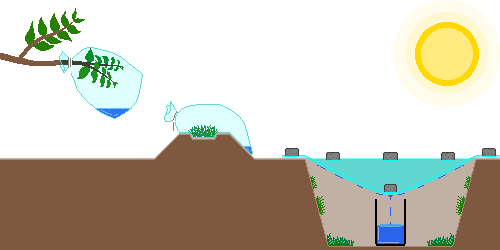
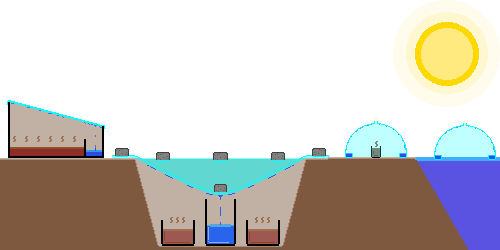
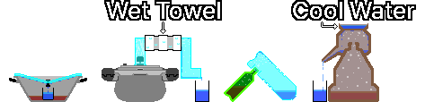

# 确保饮用水
- 来源: Youtube, Wiki, Gemini, Claude, Chat-GPT, [CDC](https://www.cdc.gov/water-emergency/about/index.html), [EPA](https://www.epa.gov/ground-water-and-drinking-water/emergency-disinfection-drinking-water)
- 编者: GoldBigDragon
---
## 1. 获取水源
&nbsp;&nbsp;&nbsp;自来水供应中断或被污染时，优先使用安全有保障的水源。未开封的瓶装水、净水器水箱、冰箱冷冻室的冰、罐头里的汤汁都属于这一类。

---
### 1-1. 替代水源
&nbsp;&nbsp;&nbsp;没有安全有保障的水源时，作为最后手段，可从以下各项中获取水。无法知道是否可饮用，而且即使经过净化、消毒，化学污染物也可能去除不掉，所以无法保证安全。如有可能，只用于清洗、打扫等卫生用途。

- 避开有悬浮物、有气味、颜色发暗的水。
- 被燃料、农药、有毒化学物质、放射性物质污染的水，无法通过煮沸、过滤、消毒变得安全，所以不要获取。
- 战区可能因爆炸、设施被毁、污水外溢而使水源受到化学和生物污染，所以选择水源要格外小心。

| 水源 | 备注 |
| --- | --- |
| 雨水 | 用集雨桶收集。经过屋顶和排水槽后，可能混入鸟粪、灰尘、金属成分 |
| 河流、湖泊 | 优先选择流速快的地点。无法确认上游污染情况时，无法保证安全 |
| 浴缸 | 灾难刚发生时用自来水蓄的水，被污染的可能性相对较低。放置很久的水会滋生细菌 |
| 露水 | 日出前，用吸水性好的布、毛巾，从没有灰尘和污染物的植物、金属板、塑料布、帐篷、塑料板等干净表面收集露水。避开农田、路边、工业设施附近 |
| 热水器水箱 | 先切断电源和热水供应，丢弃沉淀物，只用清澈的水。无法确认是否与供暖水系统相连时，不要获取 |
| 管道残留水 | 打开家里最低处的水龙头获取。无法确认管道是否被污染时，不要获取 |
| 宠物饮水器 | 混有唾液，被细菌污染的可能性高 |
| 加湿器水箱 | 滋生细菌和霉菌的可能性高 |
| 游泳池 | 氯和化学药品污染的风险高，只用于清洗、打扫等卫生用途 |
| 水床 | 很可能含有杀藻剂和防腐剂 |
| 除湿机冷凝水 | 可能被金属成分、霉菌、细菌污染 |
| 花瓶水 | 被营养剂和细菌污染的可能性高 |
| 鱼缸水 | 可能含有硝酸盐和排泄物 |
| 花盆托盘水 | 被肥料和细菌污染的可能性高 |
| 马桶水箱 | 只用马桶后面水箱里的水（不含用来如厕的马桶桶体）。只在没有化学清洁剂时才获取，可能被细菌、沉淀物、金属成分污染 |
| 锅炉供暖水 | 可能含有防冻液、防锈剂、缓蚀剂，所以不要获取 |
| 散热器水 | 可能含有防冻液、防锈剂、缓蚀剂，所以不要获取 |

---
### 1-2. 收集水分
&nbsp;&nbsp;&nbsp;替代水源不足时，可以通过自然蒸发和凝结，或植物的蒸腾作用获得少量的水。很难获得大量的水，所得的水通常比原水干净，但视设置环境和污染情况而定，无法保证安全，所以如有可能，要经过净化、消毒后再使用。

&nbsp;&nbsp;&nbsp;仅靠收集水分，很难保证一名成年人一天的水分。把它作为辅助手段而不是主要水源，如有可能，同时设置多个来增加获取量。

| 方法 | 内容 |
| --- | --- |
| 蒸腾袋 | 在无毒、叶子多的健康树枝上套上透明塑料袋并密封。阳光下植物蒸腾，塑料袋内侧会凝结出水珠。因天气条件和植物状态而不同，每天可获得约50mL |
| 植被袋 | 把无毒的草、叶子等相对安全的植物材料装入透明塑料袋并密封，暴露在阳光下。植物表面的污染物可能混入冷凝水。每天可获得约50mL |
| 太阳能蒸馏 | 用塑料布和接水的容器，使土壤和植物中的水分蒸发、冷凝而获得。坑的表面积越大，集水面积越广，含水分的物质越多，蒸发量越大。在不错的环境下每天可获得约250mL，土壤水分少或气温低时会少于此数。塑料布密封不严会降低效率，在同一位置重复操作会使土壤水分减少，产量逐渐下降 |

---

## 2. 净化
&nbsp;&nbsp;&nbsp;最好的净化不依赖单一方法，而是把从去除大颗粒到杀灭病原菌的多种技术分阶段结合起来。

| 步骤 | 内容 |
| --- | --- |
| 1. 沉淀 | 浑水装进容器，等大颗粒沉下去之后，只把上层相对清澈的水缓慢倒出 |
| 2. 过滤 | 用布、咖啡滤纸，或用砾石、沙子、木炭做的简易过滤器，去除悬浮物和大的污染物 |
| 3. 杀菌 | 通过煮沸、净水剂、氯消毒等，去除或灭活细菌、病毒、原生动物等致病微生物 |
| 4. 蒸馏（可选） | 在不怀疑有化学污染时，进一步去除病原菌、盐分和许多污染物。挥发性有机化合物（VOC）等部分低沸点化学物质无法去除 |

&nbsp;&nbsp;&nbsp;净化性能一般按蒸馏 > 煮沸 > 过滤的顺序。蒸馏对去除微生物、盐分、大部分重金属和无机污染物有效，但VOC、部分农药、燃料成分等低沸点化学物质会一起汽化而混入冷凝水。怀疑有化学污染的水，或不知道污染源的水，即使经过蒸馏也无法保证安全。

---
### 2-1. 沉淀
&nbsp;&nbsp;&nbsp;利用重力让水中的颗粒沉到底部，得到清澈的水。它有助于去除大颗粒，在煮沸泥浆多的水之前尤其有用。把水装在容器里静置几个小时，颗粒沉下去之后，只把上层清澈的水缓慢倒出。仅靠沉淀无法去除病原菌，所以一定要经过下一个净化步骤。

---
### 2-2. 过滤
#### 2-2-1. 简易过滤器
&nbsp;&nbsp;&nbsp;用布、咖啡滤纸、砾石、沙子、木炭等身边的材料层层堆叠而成。能去除沉淀物和杂质，但去除不了有害细菌和寄生虫，所以一定要经过下一个净化步骤。

| 材料 | 作用 | 厚度 |
| :---: | --- | :---: |
| 砾石 | 在最上层去除最大的异物 | 5cm以上 |
| 沙子 | 过滤比砾石更细颗粒的中间层 | 5cm以上 |
| 木炭 | 减少气味和部分有机物，改善味道。普通木炭不同于活性炭，吸附力低，只有减少部分气味和有机物的效果，无法去除病原菌 | 5cm以上 |
| 沙子 | 固定木炭并进一步过滤 | 5cm以上 |
| 布 | 铺在最下层去除细微颗粒 | 3层以上 |

#### 2-2-2. 便携式过滤器（LifeStraw等）
&nbsp;&nbsp;&nbsp;推荐绝对孔径0.2µm以下的过滤器、通过NSF P248或NSF P231认证的便携式过滤器、陶瓷过滤器和中空纤维膜（Hollow Fiber Membrane）过滤器。便携式过滤器同样无法去除重金属或VOC之类的化学污染物。

| 认证 | 内容 |
| :---: | --- |
| NSF P231 | 微生物净水器（去除细菌、病毒、原生动物） |
| NSF P248 | 军事行动用微生物净水器（包括高浊度环境） |
| NSF 53 | 减少对健康有害的物质（铅、砷、PFAS等。因认证项目而异） |
| NSF 58 | 反渗透（RO）净水系统（减少重金属、盐类、杂质） |
| NSF 401 | 减少新型污染物（药物残留、杀虫剂、除草剂等） |

---
### 2-3. 杀菌
#### 2-3-1. 净水剂
&nbsp;&nbsp;&nbsp;净水片（Tablets）和净水滴剂（Drops）用化学物质杀灭水中的细菌、病毒和其他病原菌。要严格遵守产品说明书上的用量和等待时间。

#### 2-3-2. 含氯漂白剂
&nbsp;&nbsp;&nbsp;普通含氯漂白剂（次氯酸钠）中，无香味、无色（不是Color-safe型）且不含洗涤剂、香料、表面活性剂的产品，可用于净水。

- 氯对隐孢子虫（Cryptosporidium）和部分原生动物包囊的效果有限。浑浊的水一定要先过滤再消毒。怀疑有原生动物污染时，优先选择煮沸或蒸馏。
- 加入热水中消毒效果会下降，所以尽量用常温的水。水浑浊、有颜色或非常冷时，投放量加倍。
- 加入漂白剂后充分搅匀，等待30分钟以上。水温很低（5℃以下）时消毒变慢，所以要等待60分钟以上。

&nbsp;&nbsp;&nbsp;下面是[CDC（美国疾病控制与预防中心）](https://www.cdc.gov/water-emergency/about/index.html)的标准用法。

| 消毒剂 | 浓度 | 每1L水的投放量 |
| --- | --- | --- |
| 次氯酸钠 | 5-9% | 2滴（约0.1mL） |
| 次氯酸钠 | 1% | 10滴（约0.5mL） |

#### 2-3-3. 碘酊
&nbsp;&nbsp;&nbsp;饮用水消毒中所说的碘酊，是把碘和碘化钾（或碘化钠）溶于水和乙醇的 Tincture of Iodine。它与以水为溶剂的5%或10%浓度的卢戈氏液是不同的产品。在药品柜或急救箱里通常能找到。

- 和含氯漂白剂一样，对隐孢子虫和部分原生动物包囊的效果有限。浑浊的水一定要先过滤再消毒，怀疑有原生动物污染时，优先选择煮沸或蒸馏。
- 这是紧急情况下的短期消毒方法。不适合孕妇和甲状腺疾病患者，健康成年人也不要长期连续饮用。

&nbsp;&nbsp;&nbsp;下面是[EPA（美国环境保护署）](https://www.epa.gov/ground-water-and-drinking-water/emergency-disinfection-drinking-water)的应急消毒指南。以2%碘酊为基准，不适用于5%或10%的卢戈氏液。水浑浊时优先过滤，实在不行就把添加量加倍。添加后搅匀，等待30分钟以上，水温很低（5℃以下）时等待60分钟以上。

| 消毒剂 | 浓度 | 每1L水的投放量 |
| --- | --- | --- |
| 碘酊 | 2% | 5滴（约0.25mL） |

#### 2-3-4. 煮沸
&nbsp;&nbsp;&nbsp;紧急情况下最可靠的杀菌方法。让水保持剧烈沸腾状态1分钟以上。海拔2,000m以上煮3分钟，海拔4,000m以上的极端环境至少煮5分钟。

#### 2-3-5. 紫外线消毒（SODIS）
&nbsp;&nbsp;&nbsp;利用太阳的紫外线杀灭微生物。把水装进透明、无划痕的瓶子里，横放在阳光下，晴天放置6小时，阴天放置2天。

- 日照充足时，对减少大部分细菌和病毒有效。在浊度高的水里效果会大幅下降，所以要先沉淀和过滤。
- 长时间暴露在强紫外线和热量下，容器中的化学物质可能溶出。尽量使用玻璃瓶，PET瓶不要长期重复使用。

---
### 2-4. 蒸馏
&nbsp;&nbsp;&nbsp;把污水煮沸，收集产生的水蒸气制成饮用水。它能分离污染物、盐分和矿物质，所以也用于把浑水和海水（盐水）变成淡水。VOC等低沸点化学物质会一起汽化，所以怀疑有化学污染的水，即使经过蒸馏也无法保证安全。

#### 2-4-1. 太阳能蒸馏
&nbsp;&nbsp;&nbsp;利用阳光的热量使水蒸发，收集蒸发的水蒸气获得干净的水。把盛污水的容器放在黑色底面上，可加快蒸发速度。

| 方法 | 内容 |
| --- | --- |
| 单坡式 | 在宽水槽里盛污水，倾斜安装透明板（玻璃、亚克力、塑料布）。在斜面末端放空容器，收集冷凝的水 |
| 挖坑方式 | 挖一个坑，在中间放空容器，在周围放盛污水的容器。用塑料布盖住坑口，在空容器正上方固定一块石头，使太阳热量蒸发出的水蒸气冷凝后聚集到空容器里。塑料布没有完全密封，或空容器本身被污染时要小心 |
| 集水锥（Water Cone） | 把大号PET瓶的上部切掉，把切口向内折2-3cm做成水槽，或在透明雨伞等锥形物体内侧做集水槽。把它浮在海水上，或扣在盛污水的小容器上，收集内侧水槽里冷凝的水 |

#### 2-4-2. 利用煮沸的蒸馏
&nbsp;&nbsp;&nbsp;用火把水煮沸，收集蒸发的水蒸气，获得干净的水。PET瓶在高温下会变形，并有化学物质溶出的风险，所以一定要使用耐热玻璃或耐热金属（不锈钢等）容器。

| 方法 | 内容 |
| --- | --- |
| 倒扣锅盖方式 | 使用中间带把手的圆形锅盖的锅和杯子。把空杯子放在锅的中央，往锅里倒污水，水位低于杯子高度。把锅盖倒扣盖上加热，水蒸气会聚集到锅盖中央滴进杯子里 |
| 高压锅 | 在高压锅的排气口接上耐热软管，用冷水冷却。装满污水加热，把出来的蒸汽通过软管引出。让软管中段穿过装冰或冷水的容器，蒸汽会很快冷凝 |
| 瓶子对接方式 | 在耐热玻璃或耐热金属瓶A里装污水。在耐热塑料或可以钻孔的耐热金属瓶B的底部打孔，与瓶A的瓶口对接。把瓶B的瓶口朝下倒置，加热瓶A进行蒸馏 |
| 烧酒锅（sojutgori） | 韩国传统蒸馏器具，下层放污水，中层是形似倒扣水壶的冷凝室，上层放冷却水。加热的蒸汽上升，遇到冰冷的上层冷凝，干净的水从出水口流出 |

---

## 3. 饮用水的保管
---
### 3-1. 储存容器的选择
&nbsp;&nbsp;&nbsp;饮用水储存容器必须结实、不易破碎，并且材质适合储存食品。

> **注意：**装过汽油、杀虫剂、洗涤剂、润滑油等有毒物质的容器，无论洗得多干净，都不能用来储存饮用水。

| 容器 | 内容 |
| --- | --- |
| 商品瓶装水瓶 | 未开封的商品瓶装水是最安全、最可靠的应急水源。薄的PET瓶长期使用会变形或出现裂纹，不适合反复重复使用 |
| 食品级容器 | 适合长期储存饮用水 |
| HDPE容器 | 耐用且耐化学腐蚀，应用广泛。要确认是否为经过食品用认证的产品 |
| 蓝色水箱 | 专为储存饮用水制造的适合长期保管，利于大容量储备 |
| 玻璃瓶 | 不用担心化学物质溶出且容易清洗，适合长期保管。怕冲击，水结冰时可能破裂 |
| 不锈钢保温杯 | 耐用性强，且完全遮光，抑制藻类。长期储存用含氯漂白剂消毒的水可能会腐蚀 |
| 饮料瓶 | 可用于食品，但残留糖分、香料等会滋生细菌，所以要充分洗净晾干后再使用 |
| 陶瓷 | 有利于保持凉爽的温度，但难以完全密封，而且沉重，搬运不便 |
| 牛奶盒、牛奶桶 | 容易残留乳蛋白和脂肪，难以彻底清洗，有细菌繁殖的风险，不推荐长期储存 |
| 食品级拉链袋 | 适合短期保管或冷冻保管。容易撕裂，不适合作为主要储存容器 |
| 折叠水袋 | 占地方小，但材质薄易破损，内部清洗和干燥困难 |
| 泡菜盒、塑料密封盒 | 食品用的安全且密封性好，但食物气味会渗入而影响水的口感 |
| 食品级大容量桶 | 装过食用油、糖浆等的食品级容器可以重复使用。必须彻底去除气味和残留物 |
| 工业用大容量桶 | 装过洗涤剂、润滑油、防冻液、化学药品等的容器，洗后仍可能残留有毒物质，绝对不能用来储存饮用水 |

---
### 3-2. 清洗储存容器
&nbsp;&nbsp;&nbsp;装饮用水之前一定要清洗并消毒，防止微生物生长。长期保管时，每1L水加入2滴漂白剂（次氯酸钠5-9%）后保管。

1. 清洗：用肥皂和水把容器洗干净，彻底冲洗。
2. 配制消毒液：在1L水中混入约5mL不含香料、洗涤剂、护色剂等添加物的漂白剂（次氯酸钠5%），配成约250ppm的消毒液。
3. 消毒：把消毒液倒入容器，盖上盖子，摇晃使其接触内部整个表面。
4. 等待与倒出：至少等待30秒后，倒掉消毒液。
5. 干燥与灌装：自然晾干，或倒掉消毒液后用干净的水冲洗。然后装满饮用水并密封。

---
### 3-3. 管理储存环境
&nbsp;&nbsp;&nbsp;储存的水会随时间受到周围环境的影响，所以为了保持水质，需要适当的环境和定期管理。

| 项目 | 内容 |
| --- | --- |
| 温度 | 高温会增加塑料老化和微生物繁殖的可能性。保管在10-21℃、阴凉且温度变化不大的地方 |
| 光线 | 直射阳光会使塑料劣化，并促进容器内部藻类（Algae）生长。保管在黑暗处 |
| 位置 | 食品级HDPE容器直接接触水泥地面没有太大问题。为防潮防污染，放在架子或托盘上保管 |
| 化学物质 | 汽油、杀虫剂、油漆、洗涤剂、化肥等挥发性化学物质的蒸气可能透过塑料污染水，所以一定要隔离 |
| 检查 | 在容器上标注储存日期，每6-12个月检查一次。有气味或变色的水要更换。更换下来的水可用作清洁用水或农业用水 |
| 防止二次污染 | 不要把手或脏杯子放进容器里。使用带水龙头的容器，或准备专用的舀水勺 |
| 备好净化手段 | 不要认为储存的水一直都是安全的。至少准备煮沸工具、净水过滤器、净水剂等两种以上不同的净化手段 |
| 重新充氧 | 长期储存的水溶解氧不足，口感寡淡。饮用前在两个干净的容器之间来回倒几次，口感会得到改善 |